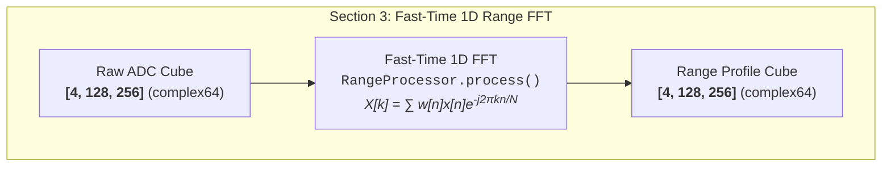

# Phase 1: Compartmentalized Jupyter Walkthroughs & Mermaid Diagrams - Research

**Date:** 2026-09-23  
**Status:** Completed  
**Phase:** 1-Compartmentalized Jupyter Walkthroughs & Mermaid Diagrams  

---

## Executive Summary

Phase 1 equips the two core project walkthrough notebooks (`01_radar_classical_dsp.ipynb` and `02_radar_deep_learning_detection.ipynb`) with top-level system architecture diagrams, discrete section-level Mermaid flowcharts, and academic narrative explanations designed for the supervising professor thesis presentation.

This research investigates the headless generation of Mermaid diagrams, notebook compatibility across environments (VS Code, JupyterLab, GitHub), SVG fallback embedding mechanisms, and the discrete stage breakdown across both notebooks.

---

## 1. Mermaid Rendering & Headless Tooling Validation

### Platform Rendering Realities
Modern development environments have differing support for native ````mermaid ```` code blocks in Jupyter notebooks:
- **VS Code Notebook Viewer**: Native support for Markdown ````mermaid ```` blocks via the built-in Markdown renderer (uses modern Mermaid engine).
- **GitHub Web Notebook Preview**: Native support for ````mermaid ```` blocks in Markdown cells.
- **JupyterLab 4.x / Jupyter Notebook 7.x**: Native support for Mermaid Markdown rendering via `@jupyterlab/mermaid-extension` (bundled by default in recent releases).
- **Legacy Jupyter Notebook (Notebook < 7, nbviewer, static exports)**: May render Mermaid as plain text or unstyled code blocks if JavaScript is disabled or missing.

### Dual-Embedding Solution (Locked Decision D-01 & D-03)
To ensure universal rendering without sacrificing modern interactive vector graphics:
1. Every diagram begins with a standard native Markdown ````mermaid ```` code block.
2. Immediately below, an HTML `<details>` collapsible container (default closed) embeds an identical vector graphic rendered as a base64-encoded SVG data URI:
```html


<details>
<summary><i>Click here to expand fallback diagram if the Mermaid graph above does not render in your environment</i></summary>
<br/>
<p align="center">
  
</p>
</details>
```

### Headless Mermaid CLI Tooling
- Verified tool: `@mermaid-js/mermaid-cli` (v11.17.0) via `npx -y @mermaid-js/mermaid-cli`.
- Execution tested and confirmed on Windows:
  ```powershell
  npx -y @mermaid-js/mermaid-cli -i diagram.mmd -o diagram.svg
  ```
- Generates clean, crisp SVGs with zero external daemon requirements.
- Integration into `scripts/build_walkthrough_notebooks.py`:
  - Python temporary file handles raw Mermaid string.
  - Subprocess calls `npx -y @mermaid-js/mermaid-cli` to compile to `.svg`.
  - SVG bytes are base64-encoded and inserted into the collapsible `<details>` markdown block.

---

## 2. Diagram Topology & Node Design Invariants

### Orientation (Decision D-05)
- **Top-Down (`graph TD`)**: Used for top-level end-to-end system flows (e.g., radar signal chain from antenna to BEV clusters, and multi-task CNN from RDM to losses). Aligns with standard vertical notebook scrolling.
- **Left-to-Right (`graph LR`)**: Used for discrete section data transformations to maintain compact height ($<160\text{ px}$) and highlight sequential tensor transitions.

### Combined Data Edge Annotations (Decision D-06)
Connections between algorithmic blocks must specify:
1. Physical Domain Name
2. Explicit Array Shape $[N_0, N_1, \dots]$
3. Data Type (`complex64`, `float32`)
*Example*: `Raw ADC Beat Signal [4, 128, 256] (complex64) -->|Hann Windowing| Windowed Samples [4, 128, 256] (complex64)`

### Operation Node Contract (Decision D-07)
Operation nodes combine:
- **Conceptual Action**: e.g., Fast-Time 1D Range FFT
- **Codebase Class & Method**: e.g., `RangeProcessor.process()`
- **Governing Math Formula**: e.g., $X[k] = \sum w[n] x[n] e^{-j 2\pi k n / N}$
- **Formatting**: Theme-neutral standard Mermaid styling without hardcoded hex fills/strokes so diagrams adapt seamlessly to the host viewer.

### Prototype Section 3 Diagram (Range FFT)


---

## 3. Inventory of Diagrams Required

### Notebook 1: `01_radar_classical_dsp.ipynb`
1. **Top-Level End-to-End System Flow (`graph TD`)**:
   - `Tx Chirps` ──► `Dechirping Mixer` ──► `Raw 3D Radar Cube [4, 128, 256]` ──► `Range FFT` ──► `MTI Filter` ──► `Doppler FFT` ──► `2D CA-CFAR` ──► `MUSIC AoA` ──► `DBSCAN` ──► `BEV Map`.
2. **Section 1: FMCW Radar Physics & Operating Equations (`graph LR`)**:
   - Transmit sawtooth chirp modulation, target delay $\tau = 2(R+vt)/c$, homodyne dechirp mixing, beat frequency $f_b = 2SR/c$.
3. **Section 2: Traffic Scenario & Raw 3D Cube (`graph LR`)**:
   - Simulation kinematics, multi-target reflection superposition, thermal noise, ground clutter tensor injection.
4. **Section 3: Fast-Time 1D Range FFT & Windowing (`graph LR`)**:
   - Hann windowing, fast-time DFT along ADC sample axis, sidelobe suppression ($-13\text{ dB} \to -31.5\text{ dB}$).
5. **Section 4: Ground Clutter Suppression via MTI (`graph LR`)**:
   - Slow-time mean subtraction across chirp sequence, zero-Doppler clutter cancellation, Clutter Attenuation (CA) calculation.
6. **Section 5: Slow-Time 2D Doppler FFT & RDM (`graph LR`)**:
   - Doppler phase shift extraction $\Delta \phi = 4\pi v T_c / \lambda$, 2D Range-Doppler Matrix construction.
7. **Section 6: Adaptive 2D CA-CFAR Detection (`graph LR`)**:
   - CUT, Guard cells, Training cells, dynamic noise floor estimation $T = \alpha P_{noise}$, peak extraction.
8. **Section 7: Spatial AoA Estimation (`graph LR`)**:
   - 4-element ULA steering vector, spatial covariance matrix $\mathbf{R}_{xx}$, eigen-decomposition, noise subspace projection, MUSIC pseudo-spectrum.
9. **Section 8: DBSCAN Clustering & Cartesian BEV (`graph LR`)**:
   - Point cloud association ($\epsilon, \text{MinPts}$), polar $(R, \theta)$ to Cartesian $(x, y)$ coordinate transform, bounding box extraction.
10. **Section 9: Pedestrian Micro-Doppler Time-Frequency Signature (`graph LR`)**:
    - Articulated swinging limbs modulation, Short-Time Fourier Transform (STFT), gait spectrogram.

### Notebook 2: `02_radar_deep_learning_detection.ipynb`
1. **Top-Level Deep Learning Perception Flow (`graph TD`)**:
   - Synthetic RDM Generation ──► Pre-Caching ──► CNN Feature Extraction ──► Multi-Task Heads ──► Multi-Task Loss ──► Inference & Visual Evaluation.
2. **Section 1: Multi-Target Dataset & Ground Truth Splatting (`graph LR`)**:
   - RDM normalization, 2D Gaussian heatmap splatting ($5$ semantic classes), continuous bounding box regression targets $[r, v, w_r, w_v]$.
3. **Section 2: Multi-Branch CNN Architecture & Loss (`graph TD` multi-branch)**:
   - Input RDM `[1, 128, 129]` ──► Conv + BatchNorm + ReLU ──► Residual Block ──► Fork into `cls_head` (5 channels) and `box_head` (4 channels) ──► Composite Loss $\mathcal{L}_{total} = \mathcal{L}_{cls} + \lambda_{box} \mathcal{L}_{box}$.
4. **Section 3: End-to-End Training & Convergence (`graph LR`)**:
   - Train/Val split, AdamW optimizer, Cosine Annealing learning rate schedule, forward pass, gradient backpropagation.
5. **Section 4: Deep Learning Inference on Unseen Scenes (`graph LR`)**:
   - Unseen test frame, forward inference, sigmoid activation, multi-channel thresholding, bounding box reconstruction.
6. **Section 5: Classical vs. Deep Learning Comparative Analysis (`graph TD`)**:
   - Trade-off matrix: Explainability vs. Close-Target Resolution vs. Clutter Resilience vs. Semantic Classification.

---

## 4. Verification & Testing Strategy (Decision D-16)

To fulfill the balanced verification mandate (*"make sure the code is working, not a full re-run but not superficial syntax-only either"*):
- Create `tests/test_walkthrough_notebooks.py`.
- **Test 1: Structure & Mermaid Completeness**:
  - Confirms both notebooks exist, are valid JSON, contain all required Markdown cells, and embed native ````mermaid ```` blocks and collapsible `<details>` fallback SVGs.
- **Test 2: Fast Smoke Execution**:
  - Programmatically executes the core DSP pipeline steps (simulator ──► Range FFT ──► MTI ──► Doppler FFT ──► CFAR ──► AoA) on a lightweight dummy cube ($N_{chirps}=16, N_{samples}=64$).
  - Programmatically executes a single forward pass of `RadarObjectDetectorCNN` on dummy tensor `[2, 1, 128, 129]`.
  - Verifies zero exceptions and correct output shapes in $<3$ seconds.
- Integrated into universal testbench `pwsh -File ./scripts/verify.ps1`.

---

## 5. Next Steps for Planning

The planning phase will produce two discrete plans:
- **Plan 01-01**: Structure and enrich `01_radar_classical_dsp.ipynb` with top-level and section-by-section Mermaid diagrams, collapsible SVG fallbacks, and polished academic narrative.
- **Plan 01-02**: Structure and enrich `02_radar_deep_learning_detection.ipynb` with multi-task DL Mermaid diagrams, collapsible SVG fallbacks, balanced smoke verification test `tests/test_walkthrough_notebooks.py`, and testbench verification.
