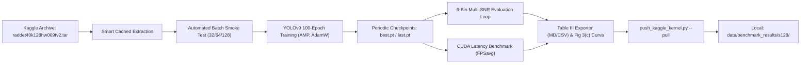

# Phase 01.2: Full-Scale RadDet Benchmark on Kaggle (S-128 Variant) — Pattern Map

**Phase:** 01.2-full-scale-raddet-benchmark-on-kaggle  
**Date:** 2026-11-02  

---

## 1. Files to be Created or Modified

| Target File | Role | Closest Analog in Codebase | Pattern Summary |
|-------------|------|---------------------------|-----------------|
| `scripts/build_raddet_notebook.py` | Notebook Code Generator | `scripts/build_walkthrough_notebooks.py` & itself | Uses AST / `nbformat` cell construction with dark-theme matplotlib styling and SVG Mermaid flowchart embeddings. |
| `03_raddet_spectrum_detection_kaggle.ipynb` | Kaggle GPU Benchmark Notebook | `03_raddet_spectrum_detection_kaggle.ipynb` & `02_radar_deep_learning_detection.ipynb` | Dual-environment dataset resolution, in-container telemetry, Ultralytics YOLOv9 training loop, and evaluation figures. |
| `scripts/push_kaggle_kernel.py` | Kaggle CLI Push & Pull Automation | `scripts/push_kaggle_kernel.py` | JSON metadata generation, file staging, Kaggle CLI execution (`kaggle kernels push`, `kaggle kernels output`), and logging. |
| `tests/test_walkthrough_notebooks.py` | Deterministic CI Verification Suite | `tests/test_raddet.py` | Unittest test cases with subprocess notebook execution or syntax validation, fast execution (<5s). |

---

## 2. Code Patterns & Reference Excerpts

### Pattern 1: Programmatic Notebook Generation (`scripts/build_raddet_notebook.py`)
```python
import nbformat as nbf

def new_code_cell(code: str) -> nbf.NotebookNode:
    return nbf.v4.new_code_cell(code.strip())

def new_markdown_cell(md: str) -> nbf.NotebookNode:
    return nbf.v4.new_markdown_cell(md.strip())

# Insert cell into notebook structure
nb = nbf.v4.new_notebook()
nb.cells.append(new_markdown_cell("## Section Title"))
nb.cells.append(new_code_cell("print('Hello Radar Benchmark')"))
```

### Pattern 2: In-Container Progress Tracking (`src.telemetry.StageProgressTracker`)
```python
from src.telemetry import StageProgressTracker

tracker = StageProgressTracker(
    stage_name="Training Phase",
    total_steps=100,
    stage_idx=4,
    total_stages=7
)
for epoch in range(100):
    # Train epoch
    tracker.step(1)
```

### Pattern 3: Dual-Mode Runtime Flag (Kaggle vs Local Smoke)
```python
import os

IS_KAGGLE = os.path.exists("/kaggle")
FULL_BENCHMARK = True if IS_KAGGLE else False

if FULL_BENCHMARK:
    EPOCHS = 100
    PATIENCE = 20
    MAX_FRAMES = 20000
else:
    # Deterministic local CI smoke test
    EPOCHS = 1
    PATIENCE = 1
    MAX_FRAMES = 10
```

### Pattern 4: CUDA-Synchronized Real-Time Latency Benchmark
```python
import torch

torch.cuda.synchronize()
start_event = torch.cuda.Event(enable_timing=True)
end_event = torch.cuda.Event(enable_timing=True)

start_event.record()
with torch.no_grad():
    _ = model(dummy_input)
end_event.record()

torch.cuda.synchronize()
latency_ms = start_event.elapsed_time(end_event)
fps = 1000.0 / latency_ms
```

---

## 3. Data Flow & Integration Contract



