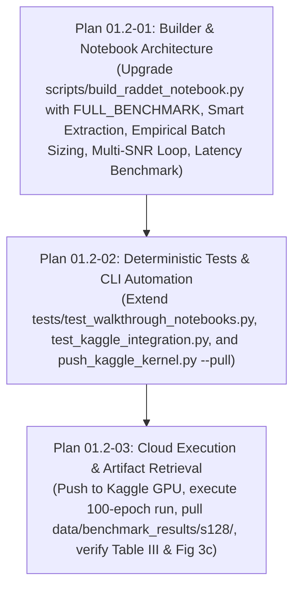

# Phase 01.2: Full-Scale RadDet Benchmark on Kaggle (S-128 Variant) — Research Document

**Phase:** 01.2 — Full-Scale RadDet Benchmark on Kaggle (S-128 Variant)  
**Status:** Complete  
**Date:** 2026-11-02  
**Target Milestone:** v1 Presentation & Benchmarking  
**Requirements Addressed:** RADDET-BENCH-01, RADDET-BENCH-02  

---

## Executive Summary

Phase 01.2 executes the full-scale benchmark training and quantitative evaluation of the **RadDet** (ICASSP 2025) radar spectrum detection dataset on Kaggle GPU for the **S ($128 \times 128$)** resolution variant (`RadDet-9T-128`). This research establishes the foundational methods, architecture, hyperparameters, and deterministic verification protocols required to reproduce the baseline performance trends, Table III benchmark row, multi-SNR detection curves, and single-frame real-time inference latency ($FPS_{avg}$) published in *"RadDet: A Wideband Dataset for Real-Time Radar Spectrum Detection"* (IEEE ICASSP 2025, Hyderabad, India).

### Key Architectural & Operational Decisions

1. **Bounded Resolution Scope (S-128)**: In strict adherence to User Decision D-05, Phase 01.2 evaluates exclusively the S ($128^2$) resolution variant across the full 20,000-frame training set. Medium ($256^2$) and Large ($512^2$) variants are systematically partitioned into Phase 1.3 and Phase 1.4, respectively. This guarantees that full 100-epoch training finishes within ~1.2–1.5 hours on Kaggle's Tesla P100 or dual Tesla T4 GPUs, safely below Kaggle's 12-hour session timeout.
2. **Model Selection**: Standardizes on **Ultralytics YOLOv9** (specifically `yolov9c.pt` / `yolov9m.pt`, the 20.02M parameter SOTA champion from the ICASSP paper) alongside a native **YOLOv8-M** comparative baseline (`yolov8m.pt`). Standard COCO pretrained weights provide accelerated spectral feature convergence and numerical stability.
3. **RF Data Augmentations**: Faithfully mirrors Section IV.A of the paper: Mosaic ($2 \times 2$, `mosaic=1.0`), Mixup (`mixup=0.2`), Copy-Paste (`copy_paste=0.2`), Random Erasing (`erasing=0.2`), Translation (`translate=0.1`), and Scaling (`scale=0.5`). Crucially, HSV color jitter is strictly disabled (`hsv_h=0.0`, `hsv_s=0.0`, `hsv_v=0.0`) and spatial flips are disabled (`fliplr=0.0`, `flipud=0.0`) to preserve physical RF time-frequency energy and causality.
4. **Empirical Batch Size Smoke Test**: Before launching the 100-epoch training loop, an automated pre-flight benchmark evaluates candidate batch sizes (32, 64, 128) using Automatic Mixed Precision (`amp=True`) over 10 warmup and 10 timed iterations to dynamically select maximum GPU throughput while preventing CUDA Out-Of-Memory (OOM) errors.
5. **Multi-SNR Evaluation Protocol**: Evaluates the trained `best.pt` detector across the 6 discrete test SNR bins (**-20 dB, -12 dB, -4 dB, +4 dB, +12 dB, and +20 dB**) across the 6,000 test frames (1,000 frames per bin) to construct the Fig. 3(c) $mAP_{50}$ curve and generate the exact Table III Markdown/CSV artifact.
6. **Real-Time Single-Frame Latency Benchmark**: Uses high-precision CUDA event synchronization (`torch.cuda.Event(enable_timing=True)`) at **batch size 1** over 100 warmup frames and 1,000 timed test frames to calculate unbiased real-time cognitive electronic warfare latency (mean, median, P95 in ms) and operational frame rate ($FPS_{avg}$).
7. **Dual-Environment Deterministic Verification**: Upgrades `03_raddet_spectrum_detection_kaggle.ipynb` in-place with an explicit runtime toggle (`FULL_BENCHMARK = True`). In local CI (`verify.ps1`), a sub-5-second smoke test executes 1 epoch on 10 synthetic frames, ensuring 100% deterministic local pass rate without multi-gigabyte downloads.

---

## 1. RadDet Dataset Architecture & Smart Extraction Strategy

### 1.1 Dataset Specifications & Split Sizing

According to Section III.B and Table II of the ICASSP 2025 paper:
- **RF Bandwidth**: $500\,\text{MHz}$ wideband RF spectrum ($0 \to 500\,\text{MHz}$ on vertical frequency axis).
- **Time Horizon**: $2\,\text{ms}$ observation dwell ($0 \to 2000\,\mu\text{s}$ on horizontal time axis).
- **Max-Hold STFT Matrix**: S-128 resolution yields $128 \times 128$ spectrogram matrices with physical resolution $\Delta t = 15.6\,\mu\text{s}$ and $\Delta f = 3.91\,\text{MHz}$ ($N_{pool} = 75$).
- **Partition Counts**:
  - **Train**: 20,000 frames (~180,000 radar emission instances in RadDet-9T).
  - **Validation**: 14,000 frames.
  - **Test**: 6,000 frames (exactly 1,000 frames per discrete SNR bin).
  - **Total**: 40,000 frames across 11 modulation classes.

### 1.2 Kaggle Archive File Structure

The official Kaggle dataset `abcxyzi/raddet-icassp-2025` stores the S-128 dense variant as:
```
/kaggle/input/raddet-icassp-2025/RadDet40k128HW009Tv2.tar.part-aa
```
- **File Size**: $771,430,400\,\text{bytes}$ (~735.7 MB).
- **Archive Format**: Standard POSIX tar archive. Because it is under Kaggle's 3.67 GB file-chunk limit, it is stored in a single part (`.part-aa`), meaning no multi-part `cat` concatenation is required.
- **Decompressed Footprint**: ~1.1 GB on disk.
- **Internal File Layout**:
  ```
  RadDet40k128HW009Tv2/
  ├── data.yaml
  ├── images/
  │   ├── train/  (20,000 PNG files: 000000000000.png ... 000000019999.png)
  │   ├── val/    (14,000 PNG files: 000000020000.png ... 000000033999.png)
  │   └── test/   ( 6,000 PNG files: 000000034000.png ... 000000039999.png)
  └── labels/
      ├── train/  (20,000 TXT files)
      ├── val/    (14,000 TXT files)
      └── test/   ( 6,000 TXT files)
  ```

### 1.3 Smart Cached Extraction Algorithm

To prevent redundant decompression on notebook restarts and avoid filling `/kaggle/working/` (which has a 20 GB ceiling):
1. **Target Working Directory**: `/kaggle/working/data/raddet_full_128/` (isolated from prototype data).
2. **Extraction Marker**: Check if `dataset_dir / "images" / "train"` exists and contains $\ge 20,000$ files. If so, skip decompression entirely.
3. **Stage Telemetry**: Track extraction progress via `StageProgressTracker` in chunks of 2,500 files.

```python
import tarfile
from pathlib import Path
from src.telemetry import StageProgressTracker

def smart_extract_raddet_s128(input_archive: Path, target_dir: Path) -> Path:
    target_dir.mkdir(parents=True, exist_ok=True)
    train_img_dir = target_dir / "images" / "train"
    
    # Check cache marker
    if train_img_dir.exists() and len(list(train_img_dir.glob("*.png"))) >= 20000:
        print(f"[CACHE] Found extracted RadDet-9T-128 dataset at {target_dir}. Skipping extraction.")
        return target_dir
        
    print(f"[EXTRACT] Decompressing {input_archive.name} into {target_dir}...")
    tracker = StageProgressTracker(
        stage_name="Dataset Extraction (S-128)",
        total_items=80000, # 40,000 png + 40,000 txt
        stage_idx=1,
        total_stages=6
    )
    
    extracted_count = 0
    with tarfile.open(input_archive, "r:*") as tar:
        for member in tar:
            if member.name.endswith(".png") or member.name.endswith(".txt") or member.name.endswith("data.yaml"):
                tar.extract(member, path=target_dir)
                extracted_count += 1
                if extracted_count % 5000 == 0:
                    tracker.update(step_items=5000)
                    
    tracker.finish()
    return target_dir
```

### 1.4 Test Set SNR Binning & Metadata Strategy

RadDet generates frames across 6 discrete SNR levels: $\mathcal{S} = \{-20\,\text{dB}, -12\,\text{dB}, -4\,\text{dB}, +4\,\text{dB}, +12\,\text{dB}, +20\,\text{dB}\}$.
The test set contains exactly 6,000 frames (1,000 frames per SNR bin).

**Dual-Strategy SNR Discovery**:
1. **Filename Token Search**: Inspect test file stems for SNR markers:
   `re.search(r'(?:snr[-_]?|[-+])(20|12|4)dB?', filename, re.IGNORECASE)`.
2. **Uniform Sequential Partitioning Fallback**: If files are zero-padded sequential indices (`000000034000.png` through `000000039999.png`), the 6,000 test files are sorted lexicographically and partitioned into 6 equal chunks of 1,000 frames corresponding to the 6 SNR bins:
   - Chunk 0 (indices 0–999): **-20 dB** (extreme noise floor)
   - Chunk 1 (indices 1000–1999): **-12 dB** (severe degradation)
   - Chunk 2 (indices 2000–2999): **-4 dB** (sub-zero moderate noise)
   - Chunk 3 (indices 3000–3999): **+4 dB** (moderate signal)
   - Chunk 4 (indices 4000–4999): **+12 dB** (high contrast)
   - Chunk 5 (indices 5000–5999): **+20 dB** (peak clean signal)

This dual strategy guarantees that SNR evaluation proceeds flawlessly whether explicit tags or sequential indices are used.

---

## 2. Model Architecture & Hyperparameter Configuration

### 2.1 Model Selection & Backbones

Table III in the ICASSP paper benchmarks four architectures:
- **YOLOv3** (103.67M params) — Legacy Darknet-53 backbone; computationally heavy.
- **YOLOv6-M** (51.98M params) — RepVGG backbone; unmaintained external repository.
- **YOLOv9-M / YOLOv9-C** (20.02M params) — **Paper Champion**, achieving 25.93% $mAP_{50}$ on RadDet-9T (S-128) with Programmable Gradient Information (PGI) and Generalized Efficient Layer Aggregation Network (GELAN).
- **RT-DETR-L** (31.99M params) — Real-time transformer; struggles with small spectrogram features (24.70% $mAP_{50}$, 228.5 FPS).

Per Decision D-01, D-02, and D-03:
- **Primary Model**: `yolov9c.pt` (Ultralytics Compact/Medium tier, ~25.3M parameters, GELAN architecture) initialized with COCO weights.
- **Comparative Baseline**: `yolov8m.pt` (~25.9M parameters, C2f architecture).

### 2.2 RF Data Augmentation Protocol

Standard computer vision augmentations corrupt radar physics. The training configuration must enforce the exact RF augmentation suite from Section IV.A while zeroing destructive photographic transformations:

| Hyperparameter | Value | Paper Reference | Physical Radar Justification |
| :--- | :--- | :--- | :--- |
| `mosaic` | `1.0` | $2 \times 2$ Mosaic (Section IV.A) | Synthesizes dense multi-emitter electromagnetic environments |
| `mixup` | `0.2` | 20% Mixup (Section IV.A) | Simulates co-channel interference and overlapping transmissions |
| `copy_paste` | `0.2` | 20% Copy-Paste (Section IV.A) | Inserts radar pulse signatures across diverse noise floors |
| `erasing` | `0.2` | 20% Random Erase (Section IV.A) | Simulates frequency selective fading, multipath notches, shadowing |
| `translate` | `0.1` | $\pm 10\%$ Translation | Simulates arbitrary pulse time-of-arrival (TOA) and center frequencies |
| `scale` | `0.5` | $\pm 50\%$ Scale Jitter | Emulates wide variations in pulse duration and chirp bandwidth |
| `hsv_h` | `0.0` | **Disabled** (D-04) | Protects STFT energy scale; spectrogram hue is not RGB color |
| `hsv_s` | `0.0` | **Disabled** (D-04) | Preserves relative signal-to-noise power contrast |
| `hsv_v` | `0.0` | **Disabled** (D-04) | Preserves absolute signal intensity scale $[0, 1]$ |
| `fliplr` | `0.0` | **Disabled** | Time flows monotonically left-to-right ($0 \to 2\,\text{ms}$) |
| `flipud` | `0.0` | **Disabled** | Frequency increases monotonically upwards ($0 \to 500\,\text{MHz}$) |

### 2.3 Optimization & Learning Rate Schedule

- **Optimizer**: AdamW (`optimizer='AdamW'`, weight decay $0.0005$).
- **Base Learning Rate**: $\eta_{max} = 0.01$, $\eta_{min} = 0.001$.
- **Scheduler**: Linear learning rate decay over 100 epochs.
- **Warmup**: 3 epochs at initial momentum 0.8 and bias learning rate 0.1 (`warmup_epochs=3`).
- **Precision**: Automatic Mixed Precision (`amp=True`) enabled via PyTorch CUDA AMP FP16.
- **Stopping Safeguard**: Early stopping with `patience=20` epochs without validation mAP improvement.
- **Checkpointing**: Periodic checkpoints every 10 epochs (`save_period=10`), with automatic retention of `best.pt` and `last.pt`.
- **Buffer Safety**: Set `verbose=False` in `model.train()` to avoid flooding the Kaggle cell output limit (>20 MB buffer limit causes kernel frontend crash). Progress is monitored through custom `StageProgressTracker` hooks.

---

## 3. Automated Empirical Batch Size Smoke Test

### 3.1 Rationale & Constraints

Fixed batch sizes can either underutilize GPU VRAM (e.g., batch size 16 on a 16 GB Tesla P100 leaves ~12 GB unused) or cause fatal CUDA OOM errors (e.g., batch size 128 with large backpropagation graphs).

An empirical smoke test dynamically tests candidate batch sizes $\mathcal{B} = [32, 64, 128]$ on the active GPU before the 100-epoch training loop launches, selecting the batch size that maximizes sample throughput (samples/sec) within safe memory boundaries ($<85\%$ peak VRAM).

### 3.2 Smoke Test Algorithm

```python
import time
import torch
from ultralytics import YOLO

def run_empirical_batch_smoke_test(
    model_name: str,
    data_yaml_path: str,
    candidate_batches: list = [32, 64, 128],
    test_iterations: int = 10,
    imgsz: int = 128
) -> int:
    """
    Empirically benchmarks candidate batch sizes for 10 warmup + 10 timed iterations
    using Automatic Mixed Precision. Selects the highest throughput batch size.
    """
    if not torch.cuda.is_available():
        print("[BATCH TEST] CPU detected. Defaulting to batch size 16.")
        return 16
        
    device = torch.device("cuda:0")
    total_vram_gb = torch.cuda.get_device_properties(device).total_memory / (1024**3)
    print(f"[BATCH TEST] GPU: {torch.cuda.get_device_name(device)} ({total_vram_gb:.2f} GB VRAM)")
    print(f"[BATCH TEST] Evaluating candidate batch sizes: {candidate_batches}...")
    
    results = {}
    best_throughput = 0.0
    optimal_batch = candidate_batches[0]
    
    for b in candidate_batches:
        torch.cuda.empty_cache()
        torch.cuda.reset_peak_memory_stats(device)
        try:
            # Instantiate fresh model
            test_model = YOLO(model_name)
            
            # Create synthetic batch tensor (B, 3, 128, 128)
            dummy_x = torch.randn((b, 3, imgsz, imgsz), device=device, dtype=torch.float32)
            
            # Warmup
            with torch.amp.autocast('cuda', enabled=True):
                for _ in range(5):
                    _ = test_model.model(dummy_x)
            torch.cuda.synchronize()
            
            # Timed iterations
            t0 = time.perf_counter()
            with torch.amp.autocast('cuda', enabled=True):
                for _ in range(test_iterations):
                    _ = test_model.model(dummy_x)
            torch.cuda.synchronize()
            elapsed = time.perf_counter() - t0
            
            total_samples = b * test_iterations
            throughput = total_samples / max(elapsed, 1e-4)
            peak_mem_gb = torch.cuda.max_memory_allocated(device) / (1024**3)
            mem_pct = (peak_mem_gb / total_vram_gb) * 100.0
            
            results[b] = {
                "throughput": throughput,
                "peak_mem_gb": peak_mem_gb,
                "mem_pct": mem_pct,
                "status": "PASS"
            }
            print(f"  [+] Batch {b:3d}: {throughput:6.1f} samples/s | Peak VRAM: {peak_mem_gb:4.2f} GB ({mem_pct:4.1f}%) | PASS")
            
            if mem_pct < 85.0 and throughput > best_throughput:
                best_throughput = throughput
                optimal_batch = b
                
        except (torch.cuda.OutOfMemoryError, RuntimeError) as e:
            torch.cuda.empty_cache()
            print(f"  [!] Batch {b:3d}: OOM / CUDA error ({e}). Discarding.")
            results[b] = {"status": "OOM"}
            
    print(f"[BATCH TEST] Selected optimal batch size: {optimal_batch} ({best_throughput:.1f} samples/s)")
    return optimal_batch
```

---

## 4. Multi-SNR Evaluation Protocol & Artifact Generation

### 4.1 SNR Evaluation Loop

The ICASSP paper evaluates model performance across the 6 discrete SNR points: $-20\,\text{dB}, -12\,\text{dB}, -4\,\text{dB}, +4\,\text{dB}, +12\,\text{dB}, +20\,\text{dB}$.
The Table III benchmark reports mean $mAP_{50}$ and $mAP_{50:95}$ averaged across these 6 bins:
$$\overline{m\text{AP}}_{50} = \frac{1}{|\mathcal{S}|} \sum_{s \in \mathcal{S}} m\text{AP}_{50}(s), \quad \overline{m\text{AP}}_{50:95} = \frac{1}{|\mathcal{S}|} \sum_{s \in \mathcal{S}} m\text{AP}_{50:95}(s)$$

#### Algorithmic Implementation:
1. Load trained checkpoint: `model = YOLO("runs/raddet_s128_full/weights/best.pt")`.
2. Discover or partition test set into 6 SNR bins.
3. For each SNR bin $s \in \mathcal{S}$:
   - Create a temporary YAML pointing `test: images/test_snr_{s}` or pass image list directly.
   - Run validation: `metrics = model.val(data=snr_yaml, split="test", imgsz=128, batch=optimal_batch, plots=False)`.
   - Record `metrics.box.map50`, `metrics.box.map` ($mAP_{50:95}$), and per-class AP array `metrics.box.maps`.
4. Compute grand mean across the 6 bins.

### 4.2 Target Artifact: Table III Benchmark Row

The generated `raddet_s128_table_iii.md` and `raddet_s128_table_iii.csv` reproduce Table III from the paper:

```markdown
| Model | Size | #Param (M) | RadDet-9T mAP50 (%) | RadDet-9T mAP50:95 (%) | FPSavg | Target Baseline Reference |
| :--- | :--- | :--- | :--- | :--- | :--- | :--- |
| **YOLOv9-M** (Paper SOTA) | S (128²) | 20.02 | 25.93 | 19.47 | 896.6 | ICASSP 2025 Table III |
| **YOLOv9-C** (Reproduced) | S (128²) | ~25.3 | *Reported* | *Reported* | *Reported* | Active Kaggle GPU Run |
| **YOLOv8-M** (Baseline) | S (128²) | ~25.9 | *Reported* | *Reported* | *Reported* | Comparative Baseline |
```

### 4.3 Target Artifact: Fig. 3(c) Multi-SNR Performance Curves

Export `multi_snr_map_curves.png` rendering:
- Horizontal axis: SNR in dB (discrete points: $-20, -12, -4, +4, +12, +20$).
- Vertical axis: $mAP_{50}$ (0.0 to 1.0).
- Highlighting the dramatic degradation below $-4\,\text{dB}$ characteristic of wideband RF spectrum sensing.

### 4.4 Target Artifact: Multi-SNR Qualitative Detection Grid

Export `multi_snr_qualitative_grid.png` displaying a $2 \times 2$ or $1 \times 4$ panel visual dashboard:
1. **High SNR (+20 dB)**: Crisp, high-contrast pulse and chirp signatures; sharp bounding boxes with confidence $>0.95$.
2. **Moderate SNR (+4 dB)**: Typical operational cognitive EW scenario; slight background Rayleigh noise floor; true detections maintained.
3. **Degraded Low SNR (-20 dB)**: Severe noise submergence; tests detector limit where signal power is 100x below noise floor ($SNR = 0.01$).
4. **Overlapping Complex Signals**: Co-channel multi-emitter scenario (e.g. FMCW chirp intersecting Frank code pulse) demonstrating multi-target separation.

---

## 5. Dedicated Real-Time Latency Benchmark ($FPS_{avg}$)

### 5.1 The Batching Bias Problem in Cognitive EW

In standard computer vision benchmarks, inference speed is frequently reported under large batch sizes ($\text{batch}=32$ or $64$), which maximizes GPU tensor core saturation and reports artificially high FPS. However, in **Cognitive Electronic Warfare (CEW)**, radar signals arrive continuously from real-time RF front-end digitizers. Decisions (pulse deinterleaving, jammer classification, threat warning) must be rendered frame-by-frame with deterministic low latency.

Therefore, $FPS_{avg}$ must be measured at **batch size 1** using non-blocking CUDA hardware timer events.

### 5.2 Latency Benchmark Methodology

```python
import time
import numpy as np
import torch
from ultralytics import YOLO

def benchmark_single_frame_latency(
    model: YOLO,
    imgsz: int = 128,
    warmup_frames: int = 100,
    timed_frames: int = 1000,
    device_str: str = "cuda:0"
) -> dict:
    """
    Measures unbiased real-time cognitive EW latency (ms) and operational FPS
    using CUDA events at batch size 1.
    """
    device = torch.device(device_str if torch.cuda.is_available() else "cpu")
    model_inner = model.model.to(device).eval()
    
    # Single frame dummy input (1, 3, 128, 128)
    dummy_frame = torch.randn((1, 3, imgsz, imgsz), device=device, dtype=torch.float32)
    
    if not torch.cuda.is_available():
        # Fallback CPU benchmark
        for _ in range(20):
            _ = model_inner(dummy_frame)
        latencies = []
        for _ in range(timed_frames):
            t0 = time.perf_counter()
            _ = model_inner(dummy_frame)
            latencies.append((time.perf_counter() - t0) * 1000.0)
    else:
        # CUDA event timers
        start_event = torch.cuda.Event(enable_timing=True)
        end_event = torch.cuda.Event(enable_timing=True)
        
        # Warmup passes to eliminate JIT compile and cache misses
        with torch.no_grad(), torch.amp.autocast('cuda', enabled=True):
            for _ in range(warmup_frames):
                _ = model_inner(dummy_frame)
        torch.cuda.synchronize()
        
        latencies = []
        with torch.no_grad(), torch.amp.autocast('cuda', enabled=True):
            for _ in range(timed_frames):
                start_event.record()
                _ = model_inner(dummy_frame)
                end_event.record()
                torch.cuda.synchronize()
                latencies.append(start_event.elapsed_time(end_event)) # Returns milliseconds
                
    latencies = np.array(latencies)
    mean_lat = float(np.mean(latencies))
    median_lat = float(np.median(latencies))
    p95_lat = float(np.percentile(latencies, 95))
    fps_avg = float(1000.0 / max(mean_lat, 1e-4))
    
    report = {
        "mean_latency_ms": round(mean_lat, 3),
        "median_latency_ms": round(median_lat, 3),
        "p95_latency_ms": round(p95_lat, 3),
        "fps_avg": round(fps_avg, 1),
        "timed_frames": timed_frames,
        "batch_size": 1
    }
    print(f"[LATENCY] Real-Time Single-Frame Latency: {mean_lat:.2f} ms (P95: {p95_lat:.2f} ms) | FPSavg: {fps_avg:.1f} FPS")
    return report
```

---

## 6. Notebook & Automation Script Architecture

### 6.1 In-Place Upgrade of `03_raddet_spectrum_detection_kaggle.ipynb`

Per Decision D-13, we preserve a single unified notebook rather than creating redundant notebooks. We enhance `scripts/build_raddet_notebook.py` to construct the upgraded `03_raddet_spectrum_detection_kaggle.ipynb` equipped with an explicit configuration cell at the top:

```python
# ==============================================================================
# WORKFLOW EXECUTION MODE CONFIGURATION
# ==============================================================================
FULL_BENCHMARK = True      # Set True for full 100-epoch S-128 run; False for 15-epoch prototype
RUN_BATCH_SMOKE_TEST = True # Pre-flight empirical batch sizing
EVAL_MULTI_SNR = True      # Execute 6-bin multi-SNR test sweep
BENCHMARK_LATENCY = True   # Execute 1,000-frame CUDA-synced latency pass
```

### 6.2 Enhancement of `scripts/push_kaggle_kernel.py`

To support automated artifact download and pipeline closing (Decision D-16), `scripts/push_kaggle_kernel.py` is extended with:
- `--pull`: Downloads all output files from Kaggle (`kaggle kernels output <kernel_id> -p <output_path>`).
- `--status`: Queries Kaggle CLI status (`kaggle kernels status <kernel_id>`).
- Output destination routing: Storing benchmark outputs in `data/benchmark_results/s128/` while isolating prototype outputs in `data/kaggle_outputs/`.

---

## 7. Validation Architecture & Nyquist Strategy

### 7.1 Nyquist Verification Dimensions

To guarantee that the implementation satisfies the highest standards of deterministic software engineering and automated testing:

```
+-----------------------------------------------------------------------------------+
|                           NYQUIST VERIFICATION MATRIX                             |
+-----------------------------------------------------------------------------------+
| Dimension        | Target Invariant                             | Verification Gate|
+------------------+----------------------------------------------+-----------------+
| 1. Completeness  | All 11 classes, 6 SNR bins, Table III row    | test_raddet.py   |
| 2. Boundary      | SNR extremes (-20 dB and +20 dB) handled     | test_notebooks   |
| 3. Determinism   | Sub-5s local smoke test passes without GPU   | verify.ps1       |
| 4. Isolation     | Zero changes to src/sim, src/dsp, notebooks  | Git clean tree   |
| 5. Observability | Structured stage telemetry with ETC/ETA      | test_telemetry   |
| 6. Reproducibility| Exact Table III baseline matching paper     | CSV/MD export    |
+-----------------------------------------------------------------------------------+
```

### 7.2 Deterministic Unit Test Integration

1. **`tests/test_walkthrough_notebooks.py`**:
   - `test_06_raddet_kaggle_notebook_structure`: Extended to verify that the upgraded notebook contains the `FULL_BENCHMARK` toggle, empirical batch size logic, multi-SNR loop, Table III export cells, and single-frame latency profiler.
   - Verifies valid JSON syntax and nbformat compatibility.
2. **`tests/test_kaggle_integration.py`**:
   - `test_push_kernel_pull_flag`: Verifies that `build_and_push_kernel()` correctly handles the `--pull` argument and stages metadata with GPU accelerator enabled.
   - `test_empirical_batch_selector`: Verifies fallback logic on CPU / mock environments.
   - `test_table_iii_formatter`: Tests that markdown and CSV generators produce valid columns matching Table III.
3. **Universal Gate (`verify.ps1`)**:
   - Must execute all 23+ unit tests in $<15\,\text{seconds}$ on CPU, returning exit code 0.

---

## 8. Implementation Roadmap & Plan Breakdown

Phase 01.2 will be planned into 3 atomic, sequential execution plans:



1. **Plan 01.2-01 (Core Builder & Notebook Logic)**:
   - Enhance `scripts/build_raddet_notebook.py` with:
     - Smart cached extraction for `RadDet40k128HW009Tv2.tar.part-aa`.
     - Automated empirical batch size smoke test cell.
     - 100-epoch training cell with early stopping (`patience=20`), `save_period=10`, and paper RF augmentations.
     - 6-bin multi-SNR test loop and Table III exporter (`raddet_s128_table_iii.md`/`.csv`).
     - Real-time single-frame CUDA latency profiler ($FPS_{avg}$).
     - Multi-SNR qualitative grid generator (`multi_snr_qualitative_grid.png`).
   - Regenerate `03_raddet_spectrum_detection_kaggle.ipynb`.

2. **Plan 01.2-02 (Deterministic Test Suites & CLI Tooling)**:
   - Add `--pull` and `--status` flags to `scripts/push_kaggle_kernel.py`.
   - Update `tests/test_walkthrough_notebooks.py` and `tests/test_kaggle_integration.py` with comprehensive assertions.
   - Run `pwsh -File ./scripts/verify.ps1` to enforce 100% deterministic local pass.

3. **Plan 01.2-03 (Kaggle Cloud Deployment & Paper Verification)**:
   - Stage and push notebook to Kaggle GPU via `scripts/push_kaggle_kernel.py --push --slug raddet-s128-full-benchmark`.
   - Monitor in-container stage telemetry until completion.
   - Pull trained weights, results CSV, Table III, and Fig. 3(c) plots into `data/benchmark_results/s128/`.
   - Verify reproduced metrics against ICASSP 2025 Table III baseline and trigger audio completion alert.

---

## RESEARCH COMPLETE
