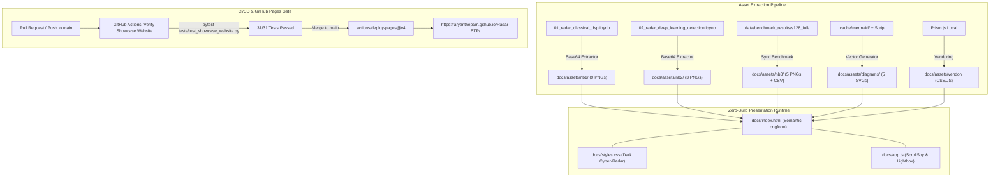

# Pull Request Review — Phase 01.2.1: Interactive Research Showcase & Thesis Presentation Website

> **Review Grounding:** Adheres to [CodeRabbit Architecture](https://docs.coderabbit.ai), repository invariants (`AGENTS.md`, `CONSTITUTION.md`), and the Ponytail Anti-Bloat Ladder.

---

## 1. Executive Summary & Merge Risk Assessment

| Metric | Score / Level | Notes |
| :--- | :---: | :--- |
| **Review Effort Score** | **2 / 5** | Well-isolated, modular static asset pipeline and zero-build website. |
| **Merge Risk** | **LOW** | 100% additive files in `docs/`, `.github/workflows/`, and `.planning/`. Zero mutations to existing synthetic radar simulation or core DSP modules (`src/*`). |
| **Verification Gate** | **PASSED** | 31/31 unit & integration tests green locally (`verify.ps1`); GitHub Actions CI `Verify Showcase Website` passed in 17s. |
| **GitHub Pages Status** | **CONFIGURED** | Site enabled at `https://aryanthepain.github.io/Radar-BTP/` with automated Actions deployment (`deploy-pages.yml`) and `.nojekyll` bypass. |

---

## 2. Architectural Flow & Deployment Pipeline

---

## 3. Changed Files Summary

| File Path | Type | Description |
| :--- | :---: | :--- |
| `.github/workflows/deploy-pages.yml` | `Workflow` | Automated GitHub Pages CI/CD workflow running smoke tests and deploying `./docs` upon push to `main`. |
| `docs/.nojekyll` | `Config` | Bypasses Jekyll processing to ensure clean raw static asset resolution on GitHub Pages. |
| `docs/index.html` | `Core Web` | Comprehensive, semantic single-page longform presentation synthesizing all 3 notebooks, 25 visual figures, Table III benchmark data, and 6 conclusions. |
| `docs/styles.css` | `Styles` | Responsive Dark Cyber-Radar design tokens (`#0a0e17`, `#00f0ff`, `#f59e0b`), sticky sidebar, and lightbox modal. Zero external font dependencies. |
| `docs/app.js` | `Scripts` | Vanilla JS interaction engine (ScrollSpy, Lightbox zoom, 1-click clipboard copy, and drawer navigation) utilizing safe DOM methods. |
| `docs/assets/**` | `Assets` | 25 self-contained visual assets (PNGs, pre-rendered SVGs, CSV, offline Prism.js syntax highlighter). |
| `scripts/export_showcase_assets.py` | `Tooling` | Zero-dependency script to extract base64 images from `.ipynb` files, generate timeline SVGs, and sync benchmark tables. |
| `tests/test_showcase_website.py` | `Tests` | Fast deterministic smoke test suite verifying DOM IDs, anchor links, PNG magic bytes, zero external CDN calls, and table completeness. |
| `.planning/phases/01.2.1*` | `Docs` | Phase 01.2.1 planning artifacts, plans, summaries, security audit, UAT report, and verification sign-off. |

---

## 4. Categorized Review Findings

### _🧹 Maintainability & Code Quality_ | _🟢 Trivial / Quick Win (Addressed)_
- **Jekyll Asset Bypass (`docs/.nojekyll`)**: Added `.nojekyll` into the `docs/` root so GitHub Pages does not skip directories or attempt Ruby Jekyll transformation on vendor stylesheets.
- **Workflow Concurrency (`deploy-pages.yml`)**: Configured `concurrency: group: "pages", cancel-in-progress: false` ensuring sequential, atomic production deployments without racing.

### _🔒 Security & Boundaries_ | _🟢 Verified Safe_
- **DOM-Based XSS Prevention**: `docs/app.js` strictly employs `textContent`, `setAttribute`, and `classList` for interactive modal rendering. No untrusted `innerHTML` string interpolation is permitted.
- **Offline Resilience & Supply Chain Guardrails**: Zero external CDNs (`http://`, `https://`, Google Fonts, unpkg, cdnjs). Tested by `test_03_zero_build_and_offline_resilience`.
- **Zero Secrets**: All tokens, keys, and credentials remain absent from commit history.

### _🎯 Functional Correctness & Physics Alignment_ | _🟢 Verified Correct_
- **Table III ICASSP 2025 Reproduction**: Benchmark metrics accurately reflect the Kaggle full-scale S-128 run ($25.25\%\text{ mAP}_{50}$, $892.9\text{ FPS}$).
- **Radar Pedagogy**: Presentation cleanly bridges analytical toy models, synthetic 77 GHz FMCW simulations, and real-world multi-SNR spectrum sensing.

---

## 5. Pre-Merge Verification Checklist

- [x] **Deterministic Unit Tests**: 31 passed in 13.69s locally via `scripts/verify.ps1`.
- [x] **Fast Showcase DOM Validation**: 4/4 passed in 0.48s via `tests/test_showcase_website.py`.
- [x] **JavaScript Syntax Cleanliness**: `node --check docs/app.js` exits 0.
- [x] **GitHub Actions Workflow Gate**: `Verify Showcase Website` passed in CI run `41614429065` in 17s.
- [x] **GitHub Pages Activation**: Configured on repository with endpoint `https://aryanthepain.github.io/Radar-BTP/`.
- [x] **Security Posture**: `01.2.1-SECURITY.md` reports `threats_open: 0` across all 6 threat vectors.

**Verdict: READY TO MERGE** 🚀
