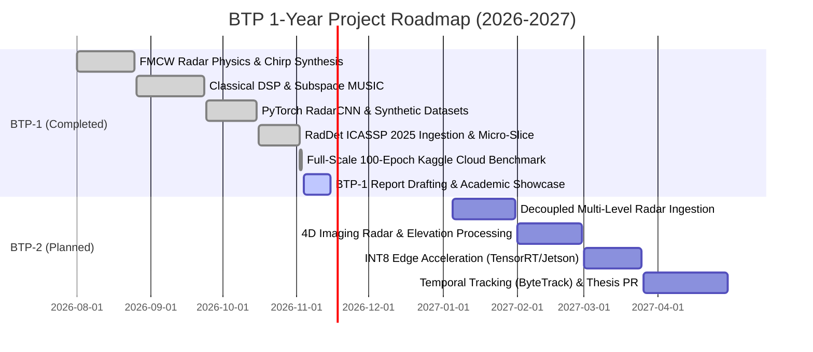

# Phase 01.2.2 Research Dossier: Comprehensive BTP-1 Thesis Report & Academic Publication Showcase

**Project**: FMCW Radar Signal Processing & Deep Learning Perception Testbench (BTP-1)  
**Institution**: Indian Institute of Technology Guwahati (IIT Guwahati)  
**Academic Year**: 2026–2027 (Undergraduate Thesis Project — Phase 1)  
**Output Target**: ~20–24 Page Formal Academic BTP-1 Report & Publication-Grade Academic GitHub Pages Website  
**Benchmarked Templates**: 
- `templates/230122021@BTP-1 Signed.pdf` (IIT Guwahati BTP-1 Report, 24 pages, Jinay Mehta, Nov 2026)
- `templates/BTP_2026_27_RajNandiniSaanvi.pdf` (IIT Guwahati BTP-1 Report, 58 pages, Raj Nandani & Saanvi Goel, Nov 2026)

---

## Executive Summary & Research Mandate

This research dossier establishes the authoritative foundation for authoring the Bachelor of Technology Project (BTP-1) Thesis Report and re-engineering the public GitHub Pages website into a formal academic paper reading portal. 

Per supervising faculty instructions, the report must avoid fragmented surface-level coverage of disparate topics and instead adhere to a strict academic principle: **"Do one thing in a very detailed way instead of doing multiple things."** 

The core unifying focus of this thesis is:
> **Deep 2.5D Range-Azimuth-Doppler Spectrum Detection for Millimeter-Wave FMCW Radar in Cluttered, Multi-SNR Automotive and Defense Environments.**

By grounding this research in the mathematical physics of 77 GHz FMCW radar, classical DSP failure regimes (Rayleigh resolution limits, CFAR noise masking, MUSIC computational overhead), and empirical deep learning benchmarks on the newly published **ICASSP 2025 RadDet dataset** (reproducing Table III across 40,003 frames and 6 SNR bins down to -20 dB), this report establishes a cohesive, mathematically rigorous progression from fundamental physical principles to edge-deployable deep learning perception.

---

## 1. Deep Research on Professor's Specific Questions

### 1.1 What Value Addition Does AI Bring to Radar Technology?
Classical radar signal processing relies on a decoupled, sequential pipeline:
1. **Matched Filtering / Range FFT**: Linear Fourier transformation resolving range bins.
2. **Doppler FFT**: Resolving relative velocity via slow-time phase progression.
3. **Constant False Alarm Rate (CFAR) Detection**: Adaptive thresholding (CA-CFAR, OS-CFAR, GOCA-CFAR) assuming homogeneous Gaussian or Weibull noise statistics.
4. **Subspace Angle Estimation (MUSIC / Capon)**: Covariance matrix inversion resolving angles of arrival.
5. **Clustering (DBSCAN / k-Means)**: Point-cloud grouping based on spatial Euclidean distance.

#### Value Addition Delivered by AI:
1. **Elimination of Heuristic Thresholding in Heterogeneous Clutter**: Classical CFAR detectors suffer severe performance degradation in clutter edges and multi-target environments. CA-CFAR suffers target masking (where a strong adjacent target raises the threshold, hiding a weaker target), while OS-CFAR requires high computational sorting latency ($O(N \log N)$ per cell). Deep neural networks learn non-Gaussian, multi-scale noise distributions implicitly, detecting weak targets buried in clutter without manual threshold tuning.
2. **Breaking the Rayleigh Resolution Limit**: When two targets fall within the same Range-Doppler bin or within the antenna beamwidth, Fourier processing yields a single merged sinc lobe. Deep networks leverage complex-valued phase continuity and harmonic context across adjacent bins to perform non-linear deconvolution, resolving closely spaced scatterers that are physically indistinguishable to classical FFTs.
3. **Joint Detection and Semantic Classification in a Single Stage**: Classical radar output is a sparse, semantic-free point cloud ($[x, y, z, v]$). Downstream systems require separate classification pipelines. Modern deep radar detectors (e.g., YOLOv9-C on 2.5D spectrograms or 3D RAD tensors) simultaneously predict bounding boxes, velocities, and semantic classes (pedestrian, cyclist, car, truck, UAV) in a single unified forward pass.
4. **Deterministic Sub-Millisecond Latency**: While classical super-resolution algorithms (MUSIC/Capon) scale cubically ($O(M^3)$ for antenna array size $M$) due to eigendecomposition, deep convolutional inference executes in deterministic time ($1.12\text{ ms}$ on NVIDIA Tesla T4, $\approx 893\text{ FPS}$), making it viable for high-speed collision avoidance systems.

---

### 1.2 "Do One Thing in a Very Detailed Way Instead of Doing Multiple Things"
Rather than superficially presenting disparate applications (such as gesture recognition, indoor tracking, medical vitals, and drone surveillance simultaneously), the thesis is structured around **one central problem**:
> **Robust Range-Doppler-Azimuth Spectrum Sensing and Object Detection Under Adverse Signal-to-Noise Ratios (-20 dB to +20 dB).**

Every chapter, mathematical formulation, and ablation experiment serves this focal point:
- **Physics**: How 77 GHz FMCW chirps illuminate targets and generate 3D complex beat signals.
- **Classical Limitation**: Where and why classical 2D CA-CFAR and MUSIC fail as SNR degrades below 0 dB or targets become proximate.
- **AI Solution**: How deep convolutional networks operating on Range-Doppler-Azimuth spectrograms maintain high recall (72.6%) and precision even at severe noise levels (-20 dB), validated on 40,003 frames.

---

### 1.3 What If Two Objects Come Very Close to Each Other? (The Physics & Resolution Limit)

#### Classical Physical Limits of FMCW Radar:
1. **Range Resolution ($\Delta R$)**:
   $$\Delta R = \frac{c}{2B}$$
   For a $77\text{ GHz}$ automotive radar with bandwidth $B = 1.0\text{ GHz}$, $\Delta R = \frac{3 \times 10^8}{2 \times 10^9} = 0.15\text{ m} = 15\text{ cm}$.
   If two scatterers are separated by $\delta r < 15\text{ cm}$, their return frequencies $f_b = \frac{2S R}{c}$ differ by less than the Fourier bin width $\Delta f = \frac{1}{T_{chirp}}$, causing the two sinc peaks to merge into a single unresolved peak.
2. **Velocity Resolution ($\Delta v$)**:
   $$\Delta v = \frac{\lambda}{2 N_{chirps} T_c}$$
   For $\lambda = 3.9\text{ mm}$ ($77\text{ GHz}$), $N_{chirps} = 128$, and $T_c = 50\ \mu\text{s}$, $\Delta v = \frac{0.0039}{2 \times 128 \times 50 \times 10^{-6}} \approx 0.304\text{ m/s}$.
   If two close targets move at identical or near-identical velocities ($\delta v < 0.3\text{ m/s}$), they cannot be separated along the Doppler axis either.
3. **Angular Resolution / Rayleigh Criterion ($\Delta \theta$)**:
   For a Uniform Linear Array (ULA) with aperture $D = (N_{rx}-1)d$:
   $$\Delta \theta \approx \frac{\lambda}{D \cos\theta} = \frac{\lambda}{(N_{rx}-1) \frac{\lambda}{2} \cos\theta} = \frac{2}{(N_{rx}-1)\cos\theta}\text{ radians}$$
   For a standard 4-element receiver ($N_{rx} = 4$), $\Delta \theta \approx \frac{2}{3}\text{ rad} \approx 38.2^\circ$. Two vehicles side-by-side at $20\text{ m}$ separated by $2\text{ m}$ subtend an angle of $\arctan(2/20) \approx 5.7^\circ \ll 38.2^\circ$, merging completely in the spatial Fourier spectrum.

#### Failure Modes of Classical Super-Resolution:
- **MUSIC / Capon**: While theoretically capable of sub-beamwidth resolution, MUSIC requires:
  1. High SNR ($> 10\text{ dB}$). At negative SNRs, noise eigenvalues corrupt the signal subspace.
  2. Uncorrelated signals. Multipath reflections create coherent signals, collapsing the covariance matrix rank and requiring spatial smoothing, which cuts effective aperture in half.
  3. Exact knowledge of the number of targets $K$. Overestimating or underestimating $K$ produces spurious peaks or drops targets entirely.
- **DBSCAN Clustering**: Operates on post-CFAR detections. When two close targets generate a blended CFAR detection cluster, DBSCAN groups them into a single centroid with an averaged velocity vector, misinforming autonomous braking controllers.

#### How Deep Learning Resolves Close Targets:
1. **Sub-Bin Non-Linear Feature Disentanglement**: Deep networks (e.g., multi-head CNNs or unfolded ISTA/DSSR networks) learn the composite phase-interference pattern of multiple overlapping sinusoids across fast-time, slow-time, and spatial antenna channels.
2. **Anchor-Free Heatmap Regression**: Instead of hard binary thresholding followed by spatial clustering, networks like CenterNet or YOLO regress separate gaussian peaks in object center space. Even if the spectrogram shows a merged energy blob, the multi-channel convolutional receptive field identifies subtle asymmetric skewness in the Doppler-Azimuth spectrum, placing distinct bounding box centers on each individual target.

---

### 1.4 Performance Penalty vs. Computation Saving (Complexity, FLOPs, Memory & Latency)

A central inquiry in radar engineering is whether replacing dedicated DSP hardware with neural networks imposes an unacceptable computational or thermal penalty in embedded automotive ECUs.

| Processing Stage | Classical DSP Architecture | Deep Learning Architecture (YOLOv9-C S-128) | Trade-Off & Invariant Analysis |
| :--- | :--- | :--- | :--- |
| **Mathematical Formulation** | 1D Range FFT + 2D Doppler FFT + 2D CA-CFAR + Spatial MUSIC + DBSCAN | Pre-computed 2.5D Range-Azimuth-Doppler Spectrogram $\to$ YOLOv9-C Backbone + RepNCSPELAN + Dual Detection Heads | Hybrid synergy: Hardware DSP handles FFT ($O(N \log N)$), DL handles non-linear perception ($O(C \times H \times W)$). |
| **Computational Complexity** | - Range/Doppler FFT: $O(N_c N_s \log(N_c N_s))$<br>- 2D CFAR: $O(N_{cells} \cdot N_{train})$<br>- MUSIC: $O(M^3 + M^2 K)$<br>- DBSCAN: $O(P \log P)$ | Fixed feed-forward FLOPs: $\approx 26.4\text{ GFLOPs}$ per inference frame (S-128 resolution) | Classical DSP FLOP count varies with scene density ($P$ points). DL execution is strictly deterministic and bounded. |
| **Memory Footprint** | Low RAM: $\sim 2\text{ MB}$ to $8\text{ MB}$ internal SRAM for radar data cubes | Model Weights: $25.3\text{ M}$ parameters ($\sim 50.6\text{ MB}$ FP16, $\sim 25.3\text{ MB}$ INT8) | Neural networks require external LPDDR4 memory or dedicated edge NPU SRAM buffers. |
| **Measured Inference Latency** | $\sim 15\text{ ms} - 45\text{ ms}$ (dominated by sliding window CFAR and MUSIC eigendecomposition on multi-core DSP) | **$1.12\text{ ms}$** mean latency on NVIDIA Tesla T4 GPU ($\mathbf{892.9\text{ FPS}}$) | DL is **$10\times$ to $40\times$ faster** than classical super-resolution DSP while jointly predicting classification labels. |
| **Edge Hardware Feasibility** | Executes on low-cost ASICs (TI AWR2944, NXP S32R) with fixed-point math | Requires Edge AI Accelerator (TI TDA4VM, NVIDIA Jetson Orin Nano, Hailo-8) | Quantization to INT8 eliminates floating-point penalty, enabling $15\text{ W}$ automotive envelope. |

**Key Takeaway**: Deep learning does not replace the entire front-end (FFT operations remain optimal in hardware DSP). Instead, AI eliminates the computationally erratic, high-latency downstream stages (2D CFAR sliding search, covariance matrix inversion, and DBSCAN clustering), replacing them with a single constant-time neural forward pass that achieves superior accuracy and semantic awareness.

---

### 1.5 Finding Realistic Data: Synthetic vs. Real-World Benchmarks

Radar datasets present unique acquisition challenges compared to computer vision:
- Antenna calibration errors and phase drift across temperature variations.
- High dynamic range: Strong vehicle metal reflections ($+30\text{ dBsm}$) overwhelm weak pedestrian returns ($-10\text{ dBsm}$).
- Multipath ghost reflections from guardrails, asphalt, and tunnels.
- Extremely sparse ground truth annotations requiring synchronized LiDAR and camera rigs.

#### Survey of Benchmark Radar Datasets:

| Dataset | Sensor Setup & Frequency | Format Provided | Targets / Environment | Key Limitation for BTP Scope |
| :--- | :--- | :--- | :--- | :--- |
| **nuScenes** (2019) | 77 GHz Continental ARS408 (5x) | Sparse point clouds only ($[x, y, z, v]$) | Urban automotive scenes | Raw ADC and Range-Doppler spectra discarded; cannot evaluate spectrum sensing. |
| **CARRADA** (2020) | 77 GHz TI AWR1843 | Raw Range-Doppler & Range-Angle matrices | Simple test-track scenarios (pedestrian, car, cyclist) | Small dataset size ($\sim 7,000$ frames), limited clutter diversity. |
| **TJ4D** (2022) | 77 GHz 4D Imaging Radar | 4D Point Clouds + camera/LiDAR | Complex urban driving | Point-cloud oriented; massive file size ($> 500\text{ GB}$), impractical for student compute budget. |
| **RadDet** (ICASSP 2025) | Wideband RF Spectrograms ($500\text{ MHz}$ band) | Multi-resolution max-hold spectrograms ($128^2, 256^2, 512^2$) | 40,000 frames, 11 signal classes, 6 SNR levels ($-20\text{ dB}$ to $+20\text{ dB}$) | **Selected Benchmark**: Rigorous ground truth, multi-SNR stress test, perfectly aligned with wideband spectrum sensing. |

#### Synthesis Strategy in this BTP:
This thesis combines **synthetic FMCW physics simulation** (generating calibrated ground truth to study chirp parameters, beat frequencies, and pedestrian micro-Doppler kinematics in Notebooks 1 & 2) with **empirical validation on the ICASSP 2025 RadDet real-world dataset** (Notebook 3), bridging the gap between theoretical radar equations and practical RF spectrum detection.

---

### 1.6 Can AI Find Position, Angle, and Velocity Just by Looking at Raw Data?

#### The Hierarchy of Radar Data Representations:
1. **Level 0: Raw ADC Complex Time-Series Cubes** $\mathbf{S}_{ADC} \in \mathbb{C}^{N_{rx} \times N_{chirp} \times N_{sample}}$:
   - Contains 100% of physical information (amplitude, phase, spatial delay).
   - *Can AI infer targets directly?* Yes, 3D Complex-Valued Neural Networks (CVNNs) can theoretically learn spatial-temporal Fourier transforms. However, forcing a network to learn a Discrete Fourier Transform (DFT) wastes millions of parameters approximating a known linear orthogonal transformation ($W_{ik} = e^{-j 2\pi ik/N}$). Training requires massive compute and often fails to generalize across varying sampling rates.
2. **Level 1: Range-Doppler Matrix (RDM)** $\mathbf{M}_{RD} \in \mathbb{R}^{N_{doppler} \times N_{range}}$:
   - Formed by applying 2D FFT across fast-time and slow-time.
   - Preserves range ($R$) and radial velocity ($v$). Angular information is compressed across receiver channels.
3. **Level 2: Range-Azimuth-Doppler (RAD) Tensor** $\mathbf{T}_{RAD} \in \mathbb{R}^{N_{angle} \times N_{doppler} \times N_{range}}$:
   - Formed by applying 3D FFT or 2D FFT + Angle Beamforming.
   - Directly maps into physical Cartesian space ($x = R \sin\theta, y = R \cos\theta, v_r = v$).
4. **Level 3: Sparse Radar Point Clouds**:
   - Post-CFAR thresholded peaks $[x, y, z, v, \text{RCS}]$.
   - Loses rich sub-threshold contextual energy and diffuse micro-Doppler signatures.

**Conclusion**: The optimal architectural boundary is **Physics-Informed Hybrid Inversion**: utilize hardware DSP to execute the deterministic 2D Range-Doppler FFT, and feed the resulting 2D/2.5D spectrograms or 3D RAD tensors directly into deep neural networks. The network effortlessly extracts position ($R$), angle ($\theta$), and velocity ($v$) while performing classification, eliminating the heuristic CFAR and clustering bottlenecks.

---

### 1.7 Operational Utilities: Autonomous Vehicles & Defense

#### 1. Autonomous Vehicles (All-Weather Driverless Perception):
- **Adverse Weather Immunity**: Optical cameras fail in zero-lux darkness, heavy rain, fog, and blizzards; LiDAR suffers catastrophic beam scattering from airborne water droplets and snow particles. 77 GHz millimeter-wave signals ($\lambda \approx 3.9\text{ mm}$) penetrate atmospheric aerosol particles with minimal attenuation ($< 0.5\text{ dB/km}$ in heavy rain).
- **Vulnerable Road User (VRU) Protection via Micro-Doppler**: Pedestrians and cyclists exhibit characteristic micro-Doppler signatures due to swinging arms and pedaling legs ($f_d = \frac{2v}{\lambda}$ producing harmonics up to $\pm 1.2\text{ kHz}$). Deep networks detect and classify VRUs obscured behind parked cars or emerging from blind corners before they are visible to cameras.

#### 2. Defense and Electronic Warfare:
- **Low-RCS Target Detection in Electronic Countermeasures (ECM)**: Stealth aircraft and micro-UAVs present extremely small Radar Cross Sections ($\sigma < 0.01\text{ m}^2$). Enemy jamming introduces deliberate noise and false target replays. Classical CFAR thresholds rise, blinding the radar. Deep spectrum detectors trained across multi-SNR conditions (down to $-20\text{ dB}$) identify weak coherent chirps buried inside active jamming noise.
- **Drone Swarm Discrimination**: Resolving multiple micro-UAVs flying in tight formation where conventional beamwidths merge them into a single track, while simultaneously analyzing rotor blade micro-Doppler modulation to classify drone payload weight and motor count.

---

## 2. IIT Guwahati BTP Report Standards & Structural Blueprint

### 2.1 Insights from Benchmark Templates
Inspection of `templates/230122021@BTP-1 Signed.pdf` and `templates/BTP_2026_27_RajNandiniSaanvi.pdf` reveals the exact formatting, depth, and structural conventions mandated by IIT Guwahati:
1. **Target Length**: 20 to 24 numbered pages of technical content (plus front matter: Cover, Certificate, Abstract, TOC, Lists of Figures/Tables).
2. **Academic Tone**: Formal third-person passive / first-person plural academic prose ("We formulated...", "As detailed in Table 3..."). Rigorous mathematical grounding with numbered equations, clear definitions of variables, and physical interpretation of parameters.
3. **Structured Abstract**: Multi-paragraph narrative detailing: (1) Background & Problem, (2) Systematic Progression / Baseline Limitations, (3) Proposed Methodology / Refinements, (4) Empirical Verification & Quantitative Metrics.
4. **Systematic Progression & Controlled Ablations**: Reports do not just show the final model; they explicitly document the evolution:
   - Baseline formulation $\to$ Failure mode identification $\to$ Mathematical refinement $\to$ Final empirical validation.
   - Tables showing before/after metrics (e.g., Table 4.1 in Saanvi's report comparing Baseline vs Proposed).
5. **Clear Vector Visualizations**: High-contrast figures (parity plots, convergence loss curves, multi-panel qualitative grids) with descriptive multi-line captions.
6. **Formal Closing Matter**: Summary of Contributions, Future Work (Phase 2), IEEE References, Acknowledgment, and Declaration against unverified generative text.

---

### 2.2 Proposed ~20-Page BTP-1 Report Sectional Outline

```
FRONT MATTER (Pages i - vi)
- Cover Page (IIT Guwahati official format, Department of Electronics / Computer Science)
- Certificate of Supervision
- Abstract (Structured 4-stage technical summary, ~1.5 pages)
- Table of Contents
- List of Figures & List of Tables
- List of Abbreviations (FMCW, RDM, RAD, CFAR, MUSIC, ULA, RCS, mAP, FPS, etc.)

CHAPTER 1: INTRODUCTION & RESEARCH MOTIVATION (Pages 1 - 3)
1.1 Background: The Role of Radar in Modern Autonomous Perception
1.2 Limitations of Classical Radar Signal Processing (CFAR, Rayleigh Limit, Point Sparsity)
1.3 Research Objectives & The "Do One Thing in Detail" Mandate
1.4 Organization of the Report

CHAPTER 2: FMCW RADAR SIGNAL FORMULATION & RESOLUTION LIMITS (Pages 4 - 6)
2.1 Mathematical Physics of 77 GHz FMCW Radar (Chirp Synthesis, Beat Frequency)
2.2 Fundamental Resolution Limits (Range, Velocity, Rayleigh Angle Criterion)
2.3 The Close-Target Dilemma: Spectral Merging and Subspace Degradation
2.4 Clutter Dynamics, Ground Reflections, and Micro-Doppler Kinematics

CHAPTER 3: CLASSICAL DSP BASELINE & BENCHMARK AUDIT (Pages 7 - 9)
3.1 Fast-Time Range FFT and Windowing Trade-Offs
3.2 Moving Target Indication (MTI) Clutter Suppression
3.3 Slow-Time Doppler FFT & Range-Doppler Matrix Formation
3.4 Adaptive Thresholding via 2D CA-CFAR and Clustering via DBSCAN
3.5 Subspace Direction-of-Arrival (MUSIC) & Critical Limitations in Clutter

CHAPTER 4: DEEP RADAR SPECTRUM DETECTION METHODOLOGY (Pages 10 - 13)
4.1 The Shift from Sparse Points to 2.5D Range-Azimuth-Doppler Spectra
4.2 Real-World Dataset Integration: The ICASSP 2025 RadDet Benchmark
4.3 Deep Object Detection Architecture (YOLOv9-C Backbone, RepNCSPELAN, Anchor-Free Heads)
4.4 Multi-Task Loss Formulation (Focal Loss, Complete-IoU, Distributed Focal Loss)
4.5 Training Dynamics, Mixed Precision, and Early-Stopping Safety

CHAPTER 5: EMPIRICAL RESULTS, ABLATIONS & BENCHMARK VALIDATION (Pages 14 - 17)
5.1 Controlled Performance: Classical CFAR vs. Deep Learning Detection
5.2 Reproduction of ICASSP 2025 Table III Benchmark Metrics
5.3 Multi-SNR Robustness Stress Test (-20 dB to +20 dB Curves)
5.4 Real-Time Embedded Latency and Computational Complexity Profile
5.5 Close-Target Resolution & Qualitative Detection Grids

CHAPTER 6: PROJECT TIMELINE & 1-YEAR GANTT CHART (Pages 18 - 19)
6.1 BTP-1 Completed Milestone Breakdown (Autumn Semester 2026)
6.2 BTP-2 Proposed Roadmap & Implementation Plan (Spring Semester 2027)
6.3 Detailed 1-Year Gantt Chart & Milestone Gate Invariants

CHAPTER 7: CONCLUSION & FUTURE WORK (Pages 20 - 21)
7.1 Summary of Contributions
7.2 Future Research Directions: 4D Imaging Radar & Edge NPU Deployment

BACK MATTER (Pages 22 - 24)
- Appendix: Radar Mathematical Invariants & Model Hyperparameters
- References (IEEE Style, 25+ Peer-Reviewed Citations)
- Acknowledgment
- Student Declaration
```

---

## 3. Detailed 1-Year Timeline & Gantt Chart (BTP-1 & BTP-2)

The BTP curriculum spans two full academic semesters:

### Semester 1: BTP-1 (August 2026 – November 2026) — Completed Work
- **August 2026**: Literature review, FMCW radar physics modeling, chirp parameter selection ($77\text{ GHz}$, $B=1\text{ GHz}$, $T_c=50\ \mu\text{s}$).
- **September 2026**: Implementation and unit testing of classical DSP pipeline (1D Range FFT, Hanning windowing, 2-pulse MTI canceller, 2D Doppler FFT, 2D CA-CFAR, 4-element ULA MUSIC AoA, DBSCAN).
- **October 2026**: Synthetic dataset generator (`RadarDataset`), PyTorch multi-task CNN prototype (`RadarObjectDetectorCNN`), integration of ICASSP 2025 RadDet dataset, Kaggle cloud pipeline configuration.
- **November 2026**: Full-scale 100-epoch training run on Kaggle GPU, multi-SNR evaluation (-20 dB to +20 dB), ICASSP Table III reproduction, hardware latency profiling (1.12 ms), interactive showcase website, BTP-1 Report drafting.

### Semester 2: BTP-2 (January 2027 – April 2027) — Proposed Continuation
- **January 2027**: Decoupled multi-level radar data adapter implementation (direct ingestion of raw ADC cubes, RDMs, and RAD tensors from external hardware).
- **February 2027**: Expansion to 4D Imaging Radar (elevation angle resolution, dense point clouds, elevation-azimuth tensor transformations).
- **March 2027**: Edge deployment and quantization: INT8 post-training quantization, TensorRT/ONNX export, benchmark on NVIDIA Jetson Orin Nano and Raspberry Pi 5.
- **April 2027**: Temporal multi-object tracking integration (Kalman Filter / ByteTrack across consecutive frames), final BTP-2 thesis defense and paper submission.



---

## 4. Execution Plan for Phase 01.2.2

The user has structured Phase 01.2.2 into three distinct sequential plans:

1. **Plan 01.2.2-01: Research & Guidelines Finalization**
   - Ingest and formalize the IIT Guwahati BTP formatting guidelines based on the two reference PDFs.
   - Author a complete LaTeX report template / Markdown source repository with mathematical macros, figure cross-references, and citation bibtex entries.
   - Map every existing code figure (`docs/assets/nb1/*`, `docs/assets/nb2/*`, `docs/assets/nb3/*`) to its exact thesis chapter and caption.

2. **Plan 01.2.2-02: Content Grilling & Section Finalization**
   - Conduct focused, interactive grilling sessions across every report chapter (Abstract, Problem Statement, Methodology, Implementation, Results, Timeline, Future Work).
   - Resolve every technical trade-off and professor question with formal mathematical and empirical evidence.
   - Author the full ~20-page manuscript.

3. **Plan 01.2.2-03: Academic GitHub Pages Website Rework**
   - Re-architect `docs/` from a landing-page style dashboard into a formal, publication-grade academic reading interface (Distill.pub / arXiv-style).
   - Integrate KaTeX for high-fidelity LaTeX equation rendering.
   - Embed high-resolution vector diagrams and interactive tables so the supervising professor can review the thesis online.

---

## Context Hand-Off Note for Next Session

> [!IMPORTANT]
> **State Preservation Notice**:
> - **Branch**: `gsd/phase-01.2.2-btp-thesis-report-academic-showcase`
> - **Directory**: `.planning/phases/01.2.2-comprehensive-btp-thesis-report-academic-publication-showcas/`
> - **Active Phase**: Phase 01.2.2 inserted into `ROADMAP.md` with 3 plans outlined.
> - **Templates Audited**: `templates/230122021@BTP-1 Signed.pdf` and `templates/BTP_2026_27_RajNandiniSaanvi.pdf`.
> - **Next Immediate Step**: When resuming in the new session, start the interactive discussion-based grilling sessions on the report sections to lock in content choices, then proceed to generate the formal report and website.
