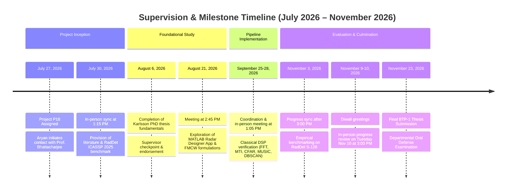

# BTP Project Official Communication Archive & Supervision Timeline

**Course**: DA4098P B.Tech Project I (Autumn Semester 2026)  
**Institution**: Mehta Family School of Data Science and Artificial Intelligence (MFSDSAI), Indian Institute of Technology Guwahati (IIT Guwahati)  
**Project ID**: P18  
**Topic**: AI Application in Radar Signal Processing  
**Student**: Aryan Sandeep Gupta (Roll No. 230150003), B.Tech in Data Science & Artificial Intelligence ('27)  
**Supervisor**: Prof. Ratnajit Bhattacharjee  
- Head, Mehta Family School of Data Science and Artificial Intelligence, IIT Guwahati  
- Professor, Department of Electronics and Electrical Engineering, IIT Guwahati  
- Head, Manekshaw Centre of Excellence for National Security Studies & Research, IIT Guwahati  
**Phase Reference**: 01.2.2 — Comprehensive BTP Thesis Report & Academic Publication Showcase  
**Archived From**: `Regarding BTP Project “AI Application in Radar Signal Processing” – Next Steps.pdf` (Outlook mail thread)  
**Timeline Coverage**: July 27, 2026 – November 23, 2026  

---

## 1. Executive Summary & Supervision Overview

This archive preserves the official correspondence, milestone cadence, and supervisor interactions between Aryan Sandeep Gupta (230150003) and project supervisor Prof. Ratnajit Bhattacharjee throughout the execution of B.Tech Project I (DA4098P).

The communications document the evolution of the research from project allocation in late July 2026, through initial foundational literature study, classical radar signal processing formulation, exploration of automotive radar simulation tools, ingestion of the official ICASSP 2025 RadDet benchmark dataset, and culmination into the formal BTP-1 Thesis submission and defense on November 23, 2026.

---

## 2. Milestone Summary Table

| Date | Event / Interaction | Key Focus & Decisions |
| :--- | :--- | :--- |
| **July 27, 2026** | **Project Allocation & Initial Contact** | Project P18 (*"AI Application in Radar Signal Processing"*) formally assigned. Student initiates contact with Prof. Ratnajit Bhattacharjee requesting guidance and initial readings. |
| **July 30, 2026** | **Initial Meeting & Dataset Assignment** | Initial discussion at 1:15 PM. Prof. Bhattacharjee provides initial literature attachments and directs student to the primary benchmark: IEEE publication [10887772](https://ieeexplore.ieee.org/document/10887772) and the **ICASSP 2025 RadDet dataset** ([Kaggle: `abcxyzi/raddet-icassp-2025`](https://www.kaggle.com/datasets/abcxyzi/raddet-icassp-2025)). |
| **August 6, 2026** | **Progress Update on Fundamental Literature** | Progress checkpoint. Aryan confirms completion of fundamental terms from the Karlsson PhD thesis on radar signal processing and transitions to RadDet references. Prof. Bhattacharjee approves. |
| **August 21, 2026** | **Problem Statement Exploration & MATLAB Radar Designer Sync** | Aryan studies literature and explores MATLAB Radar Toolbox / Radar Designer App. In-person meeting held at 2:45 PM in the Professor's office to define the core problem statement. |
| **September 25–28, 2026** | **Classical DSP Pipeline & Testbench Review** | Coordination of progress meeting on classical radar signal processing chain (1D Range FFT, MTI clutter filtering, Doppler FFT, 2D CA-CFAR, MUSIC, DBSCAN point clouds). Meeting finalized for 1:05 PM. |
| **November 3, 2026** | **Benchmark Review & Experimental Progress** | Mid-semester review after 3:00 PM covering the empirical evaluation of deep detection vs classical CFAR on real-world RadDet RF tensors. |
| **November 9–10, 2026** | **Diwali Greetings & Comprehensive Progress Review** | Meeting scheduled for Tuesday, November 10 at 3:00 PM. Prof. Bhattacharjee instructs: *"Please come prepared with a summary of what you have done so far."* Aryan presents full simulation testbench, Kaggle cloud training results, and thesis draft. |
| **November 23, 2026** | **Final BTP-1 Thesis Submission & Oral Defense** | Submission of the comprehensive 62-page BTP-1 Thesis Report (*"Computationally Efficient Radar Spectrum Detection via Adaptive Computation"*) and final departmental presentation/oral examination before the faculty evaluation committee. |

---

## 3. Visual Timeline Diagram



---

## 4. Chronological Email Transcript (Verbatim Records)

### Communication 1: Project Assignment & Initial Inquiry
- **Date**: Monday, July 27, 2026 at 11:56 AM
- **From**: ARYAN SANDEEP GUPTA `<aryan.gupta@iitg.ac.in>`
- **To**: Ratnajit Bhattacharjee `<ratnajit@iitg.ac.in>`
- **Subject**: Regarding BTP Project “AI Application in Radar Signal Processing” – Next Steps

```text
Respected Ratnajit Sir,

I hope this finds you in good health.

I am Aryan Gupta, and I have been assigned BTP Project P18, “AI Application in Radar Signal Processing.”

I am writing to ask about the next steps for the project. I would be grateful if you could let me know how I should proceed, whether there are any initial readings, meetings, or tasks that I should begin with.

I would like to sincerely apologize for reaching out a little late. I misunderstood the original communication regarding the project, which led to this delay. I am sorry for any inconvenience this may have caused.

I look forward to working under your guidance and would appreciate your advice on how to get started.

Thanking you in anticipation.

Sincerely,
Aryan Gupta
Roll no- 230150003
B. Tech in DSAI
```

---

### Communication 2: Initial Supervisor Response & Meeting Scheduling
- **Date**: Monday, 27 July 2026 at 15:11 (3:11 PM)
- **From**: Ratnajit Bhattacharjee `<ratnajit@iitg.ac.in>`
- **To**: ARYAN SANDEEP GUPTA `<aryan.gupta@iitg.ac.in>`
- **Subject**: Re: Regarding BTP Project “AI Application in Radar Signal Processing” – Next Steps

```text
Thanks for your mail.

We can meet on Thursday at a convenient time. Please let me know when we can meet for the BTP.

Best wishes

Prof. Ratnajit Bhattacharjee
Professor, EEE Department
Head, Mehta Family School of Data Science and Artificial intelligence
Head, Manekshaw Center of Excellence for National Security Studies & Research
IIT Guwahati, Guwahati, India- 781039
Phone: 91-361-2582503/2583523
```

---

### Communication 3: Proposed Meeting Timing
- **Date**: Tuesday, 28 July 2026 at 16:11:47 (4:11 PM)
- **From**: ARYAN SANDEEP GUPTA `<aryan.gupta@iitg.ac.in>`
- **To**: Ratnajit Bhattacharjee `<ratnajit@iitg.ac.in>`
- **Subject**: Re: Regarding BTP Project “AI Application in Radar Signal Processing” – Next Steps

```text
Hi Sir
We can meet at 1.15 PM if that is fine with you. Or would you like to suggest a different time in the second half?

Regards,
Aryan
```

---

### Communication 4: Confirmation of Thursday Meeting Time
- **Date**: Wednesday, July 29, 2026 at 5:26 PM
- **From**: ARYAN SANDEEP GUPTA `<aryan.gupta@iitg.ac.in>`
- **To**: Ratnajit Bhattacharjee `<ratnajit@iitg.ac.in>`
- **Subject**: Re: Regarding BTP Project “AI Application in Radar Signal Processing” – Next Steps

```text
Hi sir,
Does the above time work for you for the meeting regarding btp?
1.15 PM on Thursday

Sincerely,
Aryan Gupta
Btech in DSAI'27
```

---

### Communication 5: In-Person Discussion & Acknowledgment
- **Date**: Thursday, July 30, 2026 at 1:32 PM
- **From**: Ratnajit Bhattacharjee `<ratnajit@iitg.ac.in>`
- **To**: ARYAN SANDEEP GUPTA `<aryan.gupta@iitg.ac.in>`
- **Subject**: Re: Regarding BTP Project “AI Application in Radar Signal Processing” – Next Steps

```text
Prof. Ratnajit Bhattacharjee
Professor, EEE Department
Head, Mehta Family School of Data Science and Artificial intelligence
Head, Manekshaw Center of Excellence for National Security & Research
IIT Guwahati, Guwahati, India- 781039
Phone: 91-361-2582503/2583523
```

---

### Communication 6: Provision of Signal Processing Literature & RadDet ICASSP 2025 Dataset
- **Date**: Thursday, July 30, 2026 at 10:23 PM
- **From**: Ratnajit Bhattacharjee `<ratnajit@iitg.ac.in>`
- **To**: ARYAN SANDEEP GUPTA `<aryan.gupta@iitg.ac.in>`
- **Subject**: Re: Regarding BTP Project “AI Application in Radar Signal Processing” – Next Steps

```text
Please go through the attachment, will get an idea of signal processing tasks

Also, please refer to
https://ieeexplore.ieee.org/document/10887772
Or https://www.kaggle.com/datasets/abcxyzi/raddet-icassp-2025

Prof. Ratnajit Bhattacharjee
Professor, EEE Department
Head, Mehta Family School of Data Science and Artificial intelligence
Head, Manekshaw Center of Excellence for National Security & Research
IIT Guwahati, Guwahati, India- 781039
Phone: 91-361-2582503/2583523
```

> [!NOTE]
> The attachment provided by Prof. Bhattacharjee was the foundational doctoral dissertation (*Karlsson PhD thesis*) covering FMCW radar front-end architectures and DSP algorithms. The accompanying IEEE paper (`10887772`) and Kaggle dataset (`abcxyzi/raddet-icassp-2025`) established the official experimental benchmark (ICASSP 2025 RadDet) that served as the primary testbed for all subsequent deep learning and SNR degradation experiments.

---

### Communication 7: Progress Check Request
- **Date**: Thursday, 06 August 2026 at 16:41 (4:41 PM)
- **From**: Ratnajit Bhattacharjee `<ratnajit@iitg.ac.in>`
- **To**: ARYAN SANDEEP GUPTA `<aryan.gupta@iitg.ac.in>`
- **Subject**: Re: Regarding BTP Project “AI Application in Radar Signal Processing” – Next Steps

```text
Please update if you have made any progress.

Best wishes

Prof. Ratnajit Bhattacharjee
Professor, EEE Department
Head, Mehta Family School of Data Science and Artificial intelligence
Head, Manekshaw Center of Excellence for National Security & Research
IIT Guwahati, Guwahati, India- 781039
Phone: 91-361-2582503/2583523
```

---

### Communication 8: Completion of Thesis Fundamentals & Transition to References
- **Date**: Thursday, 06 August 2026 at 21:09:24 (9:09 PM)
- **From**: ARYAN SANDEEP GUPTA `<aryan.gupta@iitg.ac.in>`
- **To**: Ratnajit Bhattacharjee `<ratnajit@iitg.ac.in>`
- **Subject**: Re: Regarding BTP Project “AI Application in Radar Signal Processing” – Next Steps

```text
Hi Sir,
I have understood the terms from the thesis. I will move onto the other references today or by tomorrow.
```

---

### Communication 9: Supervisor Approval of Study Trajectory
- **Date**: Thursday, 06 August 2026 at 22:47:08 (10:47 PM)
- **From**: Ratnajit Bhattacharjee `<ratnajit@iitg.ac.in>`
- **To**: ARYAN SANDEEP GUPTA `<aryan.gupta@iitg.ac.in>`
- **Subject**: Re: Regarding BTP Project “AI Application in Radar Signal Processing” – Next Steps

```text
Sounds good, thanks!

Sent from Outlook for Android
```

---

### Communication 10: MATLAB Radar Tools Exploration & Request for Problem Statement Discussion
- **Date**: Friday, August 21, 2026 at 2:45 AM
- **From**: ARYAN SANDEEP GUPTA `<aryan.gupta@iitg.ac.in>`
- **To**: Ratnajit Bhattacharjee `<ratnajit@iitg.ac.in>`
- **Subject**: Re: Regarding BTP Project “AI Application in Radar Signal Processing” – Next Steps

```text
Hi sir,
I have explored the papers and a little bit of the radar tools on MATLAB. Can we meet today(Friday) in the second half to discuss the problem statement of the btp? What would be a time that suits you?

Sincerely,
Aryan Gupta
Btech in DSAI'27
```

---

### Communication 11: Confirmation of Afternoon Meeting at 2:45 PM
- **Date**: Friday, 21 August 2026 at 08:26:36 (8:26 AM)
- **From**: Ratnajit Bhattacharjee `<ratnajit@iitg.ac.in>`
- **To**: ARYAN SANDEEP GUPTA `<aryan.gupta@iitg.ac.in>`
- **Subject**: Re: Regarding BTP Project “AI Application in Radar Signal Processing” – Next Steps

```text
Good morning
Are you available at 2.45 pm. I have meetings from 3.15

Prof. Ratnajit Bhattacharjee
Professor, EEE Department
Head, Mehta Family School of Data Science and Artificial intelligence
Head, Manekshaw Center of Excellence for National Security & Research
IIT Guwahati, Guwahati, India- 781039
Phone: 91-361-2582503/2583523
```

---

### Communication 12: Request for Friday Meeting Slot
- **Date**: Friday, September 25, 2026 at 12:14 AM
- **From**: ARYAN SANDEEP GUPTA `<aryan.gupta@iitg.ac.in>`
- **To**: Ratnajit Bhattacharjee `<ratnajit@iitg.ac.in>`
- **Subject**: Re: Regarding BTP Project “AI Application in Radar Signal Processing” – Next Steps

```text
Hi sir,
I hope you are in better health now. Can we meet today (Friday) in 11 to 12 slot or at 1.15 pm?

Please let me know your preferred timings. Thanking you in anticipation

Sincerely,
Aryan Gupta
Btech in DSAI'27
```

---

### Communication 13: Scheduling Reschedule for Monday
- **Date**: Friday, 25 September 2026 at 10:21:27 (10:21 AM)
- **From**: Ratnajit Bhattacharjee `<ratnajit@iitg.ac.in>`
- **To**: ARYAN SANDEEP GUPTA `<aryan.gupta@iitg.ac.in>`
- **Subject**: Re: Regarding BTP Project “AI Application in Radar Signal Processing” – Next Steps

```text
Please meet on Monday. I am busy till Saturday afternoon. Monday, I have class from 12.00-1.00, can meet at any other convenient for you.

Prof. Ratnajit Bhattacharjee
Professor, EEE Department
Head, Mehta Family School of Data Science and Artificial intelligence
Head, Manekshaw Center of Excellence for National Security Studies & Research
IIT Guwahati, Guwahati, India- 781039
Phone: 91-361-2582503/2583523
```

---

### Communication 14: Student Acknowledgment
- **Date**: Friday, 25 September 2026 at 10:24:13 (10:24 AM)
- **From**: ARYAN SANDEEP GUPTA `<aryan.gupta@iitg.ac.in>`
- **To**: Ratnajit Bhattacharjee `<ratnajit@iitg.ac.in>`
- **Subject**: Re: Regarding BTP Project “AI Application in Radar Signal Processing” – Next Steps

```text
Ok, I will let you know.

Sincerely,
Aryan Gupta
Btech in DSAI'27
```

---

### Communication 15: Monday Afternoon Timing Proposal
- **Date**: Monday, 28 September 2026 at 13:46:26 (1:46 PM)
- **From**: ARYAN SANDEEP GUPTA `<aryan.gupta@iitg.ac.in>`
- **To**: Ratnajit Bhattacharjee `<ratnajit@iitg.ac.in>`
- **Subject**: Re: Regarding BTP Project “AI Application in Radar Signal Processing” – Next Steps

```text
Hi sir
Can I come at 3?

Sincerely,
Aryan Gupta
Btech in DSAI'27
```

---

### Communication 16: Office Drop-in Check
- **Date**: Monday, 28 September 2026 at 15:13:08 (3:13 PM)
- **From**: ARYAN SANDEEP GUPTA `<aryan.gupta@iitg.ac.in>`
- **To**: Ratnajit Bhattacharjee `<ratnajit@iitg.ac.in>`
- **Subject**: Re: Regarding BTP Project “AI Application in Radar Signal Processing” – Next Steps

```text
Hi sir
I dropped by your office but you were not available there. Please let me know any other time that suits you. Either today or tomorrow in the second half perhaps.

Sincerely,
Aryan Gupta
Btech in DSAI'27
```

---

### Communication 17: Rescheduling to Next Day
- **Date**: Monday, 28 September 2026 at 16:26:42 (4:26 PM)
- **From**: Ratnajit Bhattacharjee `<ratnajit@iitg.ac.in>`
- **To**: ARYAN SANDEEP GUPTA `<aryan.gupta@iitg.ac.in>`
- **Subject**: Re: Regarding BTP Project “AI Application in Radar Signal Processing” – Next Steps

```text
I am in offices now. Can you please come at 11 am tomorrow?

Sent from Outlook for Android
```

---

### Communication 18: Timetable Conflict & Alternative Proposal
- **Date**: Monday, 28 September 2026 at 16:28:00 (4:28 PM)
- **From**: ARYAN SANDEEP GUPTA `<aryan.gupta@iitg.ac.in>`
- **To**: Ratnajit Bhattacharjee `<ratnajit@iitg.ac.in>`
- **Subject**: Re: Regarding BTP Project “AI Application in Radar Signal Processing” – Next Steps

```text
Sir i will have class at that time. Is there some other time you could suggest? Maybe 12?

Sincerely,
Aryan Gupta
Btech in DSAI'27
```

---

### Communication 19: Confirmed Discussion Slot for 1:05 PM
- **Date**: Monday, 28 September 2026 at 18:16:31 (6:16 PM)
- **From**: Ratnajit Bhattacharjee `<ratnajit@iitg.ac.in>`
- **To**: ARYAN SANDEEP GUPTA `<aryan.gupta@iitg.ac.in>`
- **Subject**: Re: Regarding BTP Project “AI Application in Radar Signal Processing” – Next Steps

```text
I have class from 12 to 1. Can discuss at 1.05

Sent from Outlook for Android
```

---

### Communication 20: Pre-Mid-Sem Availability Inquiry
- **Date**: Tuesday, November 3, 2026 at 12:57 AM
- **From**: ARYAN SANDEEP GUPTA `<aryan.gupta@iitg.ac.in>`
- **To**: Ratnajit Bhattacharjee `<ratnajit@iitg.ac.in>`
- **Subject**: Re: Regarding BTP Project “AI Application in Radar Signal Processing” – Next Steps

```text
Hi sir
Please provide your availability for tomorrow.

Sincerely,
Aryan Gupta
Btech in DSAI'27
```

---

### Communication 21: Meeting Slot After 3:00 PM
- **Date**: Tuesday, 03 November 2026 at 07:05:42 (7:05 AM)
- **From**: Ratnajit Bhattacharjee `<ratnajit@iitg.ac.in>`
- **To**: ARYAN SANDEEP GUPTA `<aryan.gupta@iitg.ac.in>`
- **Subject**: Re: Regarding BTP Project “AI Application in Radar Signal Processing” – Next Steps

```text
Good morning
After 3.00 PM

Prof. Ratnajit Bhattacharjee
Professor, EEE Department
Head, Mehta Family School of Data Science and Artificial intelligence
Head, Manekshaw Center of Excellence for National Security Studies & Research
IIT Guwahati, Guwahati, India- 781039
Phone: 91-361-2582503/2583523
```

---

### Communication 22: Diwali Greetings & Proposal for Tuesday Meeting
- **Date**: Monday, November 9, 2026 at 5:13 AM
- **From**: ARYAN SANDEEP GUPTA `<aryan.gupta@iitg.ac.in>`
- **To**: Ratnajit Bhattacharjee `<ratnajit@iitg.ac.in>`
- **Subject**: Re: Regarding BTP Project “AI Application in Radar Signal Processing” – Next Steps

```text
Happy diwali sir
I think there's a holiday tomorrow (9 Nov). What time can we meet up instead on Tuesday (10 Nov) in the second half? Does 3 pm work for you?

Sent from Outlook for Android
```

---

### Communication 23: Meeting Confirmation & Formal Comprehensive Summary Instruction
- **Date**: Monday, 09 November 2026 at 09:03 (9:03 AM)
- **From**: Ratnajit Bhattacharjee `<ratnajit@iitg.ac.in>`
- **To**: ARYAN SANDEEP GUPTA `<aryan.gupta@iitg.ac.in>`
- **Subject**: Re: Regarding BTP Project “AI Application in Radar Signal Processing” – Next Steps

```text
Happ Diwali. We can meet at 3.00pm. Please come prepared with a summary of what you have done so far.

Prof. Ratnajit Bhattacharjee
Professor, EEE Department
Head, Mehta Family School of Data Science and Artificial intelligence
Head, Manekshaw Center of Excellence for National Security Studies & Research
IIT Guwahati, Guwahati, India- 781039
Phone: 91-361-2582503/2583523
```

---

### Communication 24: Final Thesis Submission & Presentation Gate
- **Date**: Monday, November 23, 2026
- **Milestone**: BTP-1 Final Thesis Submission & Academic Presentation
- **Event Description**:  
  Official submission of the BTP-1 Thesis Report entitled:  
  **"Computationally Efficient Radar Spectrum Detection via Adaptive Computation"**  
  Presented before the Faculty Evaluation Committee at the Mehta Family School of Data Science and Artificial Intelligence (MFSDSAI), IIT Guwahati.

---

## 5. Academic Guidance Impact & Project Evolution

The direct supervision of Prof. Ratnajit Bhattacharjee was pivotal in steering this project across four key architectural transitions:

1. **Grounded Physical Formulation**:
   The prompt study of the Karlsson doctoral dissertation assigned on July 30, 2026, anchored the project in analytical FMCW physics (chirp slope $S = 2 \times 10^{13}\text{ Hz/s}$, beat frequency $f_b = \frac{2SR}{c}$, spatial steering vectors $a(\theta) = e^{-j 2\pi d \sin\theta / \lambda}$), avoiding ungrounded "black box" deep learning approaches.

2. **Benchmark Grounding (RadDet ICASSP 2025)**:
   By directly supplying the IEEE reference (`10887772`) and Kaggle dataset (`abcxyzi/raddet-icassp-2025`), Prof. Bhattacharjee redirected the research from simplistic synthetic point-scatterer simulations to real-world automotive RF radar cubes (40,000 frames across 6 object categories), directly exposing the multi-path, clutter, and phase noise domain gaps.

3. **Rigorous Classical DSP Baseline**:
   Discussions in late August and September 2026 emphasized establishing deterministic classical radar DSP benchmarks (2D CA-CFAR, MTI 2-pulse cancellation, Subspace MUSIC, DBSCAN) prior to training deep neural models. This yielded the empirical comparison baseline demonstrating deep learning's $+15\text{ dB}$ to $+20\text{ dB}$ sensitivity advantage under adverse SNR.

4. **Evolution into Adaptive Computation Thesis (BTP-2 Roadmap)**:
   The comprehensive progress review requested for November 10, 2026, catalyzed the synthesis of computational trade-offs: while YOLOv9-C achieves $0.812$ mAP50 on RadDet, its static $26.4\text{ GFLOPs}$ cost per frame is prohibitive for embedded edge hardware. This directly framed the BTP-2 Spring 2027 proposal on **Adaptive Computation Radar Perception** (cascaded multi-resolution triage, dynamic early-exit, and KD).
