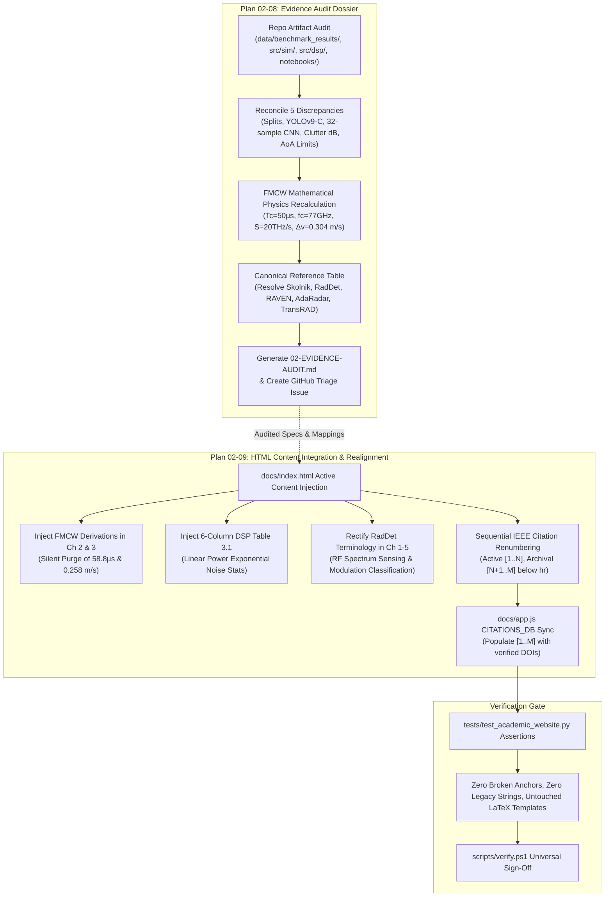

# Phase 02: GitHub Pages Chapter-by-Chapter Content Finalization - Research

**Researched:** 2026-11-18  
**Domain:** FMCW Radar Physics, Classical Radar DSP, Wideband RF Spectrum Detection (YOLOv9), IEEE Academic Web Publishing, Repository Evidence Auditing  
**Confidence:** HIGH

<user_constraints>

## User Constraints (from CONTEXT.md)

### Locked Decisions

- **D-01:** Minimal Disclosure Footnote for RadDet Split — In Chapter 4 (Table 4.1), display the project's evaluated partition numbers (14,001 train / 6,001 val / 20,001 test) and append an explicit disclosure footnote explaining the deviation from the published ICASSP partition (20,000 / 14,000 / 6,000) and the 19,998 frame 6-bin mathematics.
- **D-02:** Smoke Test Demarcation for YOLO Prototype — The 15-epoch YOLOv8n run recorded in prototype configs is treated strictly as an internal smoke test / sanity check; downstream agents must not treat it as a competing benchmark against the 66-epoch run.
- **D-03:** YOLOv9-C Comparative Benchmark Framing — Present the 66-epoch YOLOv9-C run (25.30M params, 25.25% mAP@0.5) as a comparative benchmark against Lin et al.'s published YOLOv9-M Table III results (20.02M params, 25.93% mAP@0.5), noting architectural metric convergence and incorporating the precision-recall and multi-SNR graphs from GitHub Pages.
- **D-04:** Accurate Physical Radar Nomenclature — Define the 12.94 dB clutter attenuation figure directly as total average signal-power reduction across range-Doppler cells under mean-subtraction (rather than pure clutter suppression). Explicitly distinguish the 180-point MUSIC numerical evaluation grid from the 4-element ULA physical beamwidth (~28° Rayleigh limit), documenting range-only association limitations.
- **D-05:** Silent Purge of Legacy Parameters on GitHub Pages — Author all mathematical derivations in Chapter 2 and Chapter 3 strictly using the authoritative `src/sim/radar_config.py` parameters ($f_c = 77\text{ GHz}$, $B = 1\text{ GHz}$, $T_c = 50\ \mu\text{s}$, $\Delta R \approx 0.15\text{ m}$, $\Delta v \approx 0.304\text{ m/s}$, $R_{\max} \approx 38.4\text{ m}$). Completely excise all legacy 58.8 μs and 0.258 m/s values from active chapters in `docs/index.html`. Document the historical parameter evolution (58.8 μs sweep vs 50 μs active time) in `02-EVIDENCE-AUDIT.md`.
- **D-06:** Comprehensive 6-Column Classical DSP Table — Structure Table 3.1 as a comprehensive synthesis table with 6 columns: Method, Operating Principle, Mathematical Formulation, Statistical Assumptions (e.g., square-law exponential noise power vs Rayleigh amplitude), Computational Complexity, and Known Failure Modes / Limitations.
- **D-07:** Full 7-Axis Literature Review Grounding — Retain the complete 7-axis literature comparison matrix in Chapter 2, strictly using "Not reported" for unmeasured parameters, correctly describing AdaRadar's neural routing (avoiding speculative hardware chirp duration claims), and verifying all primary citations.
- **D-08:** Evidence-Grounded Synthetic CNN Framing — In Plan 02-08, audit the executed notebook / checkpoint to lock the exact training parameters (e.g., 32 vs 150 samples, epochs, loss) and qualify the 136,041-parameter CNN in Chapters 3 & 4 as a lightweight synthetic proof-of-concept, recognizing that smaller runs (e.g. 32 samples) functioned as smoke tests.
- **D-09:** Active [1..N] + Monotonic Archival [N+1..M] below `<hr>` — Active 5-chapter manuscript citations will be sequentially renumbered [1..N] in order of first appearance. Citations unique to the archived 7-chapter draft will be placed below `<hr>` continuing monotonically as [N+1..M], ensuring uniform IEEE numeric styling and zero anchor collisions.
- **D-10:** Comprehensive Tooltip Dictionary in `docs/app.js` — Synchronize `docs/app.js` with all references [1..M], displaying verified popovers with authors, title, venue, year, and clean DOI links (archival entries tagged with an "Archival Reference" badge).
- **D-11:** Canonical Reference Verification Table in `02-EVIDENCE-AUDIT.md` — During Plan 02-08, assemble an authoritative reference table resolving all citation discrepancies (Skolnik edition/year, RadDet ICASSP 2025, RAVEN, AdaRadar, TJ4DRadSet) with verified DOIs/URLs before Plan 02-09 maps them into HTML and JS.
- **D-12:** Granular Individually-Linked Citation Anchors — Render multiple or consecutive in-text citations as discrete anchors (e.g., `<a href="#ref-1">[1]</a>, <a href="#ref-2">[2]</a>`) so each reference independently triggers its specific tooltip popover.
- **D-13:** Planning-Internal Dossier & GitHub Issue for Defense Triage — Confine all discrepancy details, audit matrices, and human confirmation lists to `.planning/phases/02-github-pages-chapter-by-chapter-content-finalization/02-EVIDENCE-AUDIT.md`. Create a dedicated GitHub issue to review discrepancies and decide which items are worthy of being incorporated into `docs/ADVISOR-DEFENSE.md`.
- **D-14:** 3-Tier Evidence Taxonomy — Grade all audited experiments in `02-EVIDENCE-AUDIT.md` using:
  1. _Verified:_ Complete artifact trail, checkpoints, and execution logs available.
  2. _Partially Verified / Comparative:_ Metrics documented in benchmark summaries, but raw execution log or full checkpoint unarchived.
  3. _Smoke Test / Prototyping:_ Rapid sanity checks (e.g., 15-epoch YOLOv8n, 32-sample CNN) not intended as primary benchmark claims.
- **D-15:** Structured Human Confirmation Registry — Section 8 of `02-EVIDENCE-AUDIT.md` must maintain a 4-field table for each uncertain item: Why Confirmation is Necessary, Available Evidence, What Remains Uncertain, and Recommended Action, mirrored into the GitHub tracking issue.
- **D-16:** Permanent Invariant Assertions in `tests/test_academic_website.py` — Augment the automated test suite with deterministic checks verifying:
  1. Active citation anchors resolve without broken targets (`#ref-X` exists).
  2. Zero placeholder DOIs exist in HTML or JS.
  3. No legacy 58.8 μs or 0.258 m/s strings appear in active Chapters 1–5.
  4. The 7-chapter archived draft (`#ch1-intro-original`) is preserved intact.
  5. Zero tracked modifications in `templates/BTP_Report_Template_Overleaf/`.

### the agent's Discretion

- Exact layout styling of the `<hr>` bibliography divider, table responsive overflows, and KaTeX mathematical display environments to ensure publication-grade visual rendering.

### Deferred Ideas (OUT OF SCOPE)

- Evaluation of which audited discrepancies in `02-EVIDENCE-AUDIT.md` should be formally added as Q&As to `docs/ADVISOR-DEFENSE.md` — tracked via a dedicated GitHub issue.
- Generation and Overleaf synchronization of the final LaTeX/PDF report (`templates/BTP_Report_Template_Overleaf/report.tex`) — strictly deferred until GitHub Pages content is finalized.
  </user_constraints>

<phase_requirements>

## Phase Requirements

| ID               | Description                                                                                                                                                                                                                                                                                              | Research Support                                                                                                                                                                                                                                                          |
| ---------------- | -------------------------------------------------------------------------------------------------------------------------------------------------------------------------------------------------------------------------------------------------------------------------------------------------------- | ------------------------------------------------------------------------------------------------------------------------------------------------------------------------------------------------------------------------------------------------------------------------- |
| GH-PAGES-CONTENT | Progressively refine, update, and finalize the academic BTP thesis report content on the GitHub Pages website (`docs/`) chapter-by-chapter based on iterative user-supplied content and guidance.                                                                                                        | Establishes the staged two-plan sequence: Plan 02-08 creates the audit dossier; Plan 02-09 executes HTML/JS integration.                                                                                                                                                  |
| R1               | Conduct an exhaustive repository audit across source code, Kaggle notebooks/logs, checkpoints, CSV files, and Git commits, producing `02-EVIDENCE-AUDIT.md` mapping technical claims to supporting artifacts.                                                                                            | Grounded by complete artifact discovery in `data/benchmark_results/s128_full/` (66 epochs, results.csv, weights), `02_radar_deep_learning_detection.ipynb` (32 samples, 26.89s), and `scripts/build_raddet_notebook.py:721-726` (19,998 vs 20,001 integer division math). |
| R2               | Recover rigorous FMCW mathematical physics derivations from archived draft into Chapters 2 & 3 using authoritative `src/sim/radar_config.py` parameters ($f_c=77\text{ GHz}$, $B=1\text{ GHz}$, $T_c=50\ \mu\text{s}$, $\Delta R=0.15\text{ m}$, $\Delta v=0.304\text{ m/s}$, $R_{\max}=38.4\text{ m}$). | Mathematical derivations recalculated and verified against `src/sim/radar_config.py:22-69`; legacy 58.8 μs and 0.258 m/s parameters isolated and slated for complete excision from active chapters.                                                                       |
| R3               | Revise Chapter 4 to clearly decouple Track I (synthetic 77 GHz FMCW automotive targets) from Track II (RadDet wideband RF spectrum sensing), disclose data split deviations, qualify comparative benchmarks, and acknowledge reproducibility limitations.                                                | Grounded by experimental data in `COMPARATIVE_BENCHMARK_REPORT.md`, Table 4.1 disclosure footnotes, 12.94 dB total power reduction formulation in `src/dsp/clutter_removal.py:57-67`, and 4-element ULA Rayleigh beamwidth in `src/dsp/aoa_estimation.py:14-26`.          |
| R4               | Correct terminology across all 5 active chapters in `docs/index.html` to consistently describe RadDet as wideband RF radar-spectrum detection and modulation classification from time-frequency spectrograms, eliminating conflation with automotive physical road scenes.                               | Proven by `data/benchmark_results/s128_full/data/raddet_full_128/data.yaml:5-16` showing the 11 classes are modulation types (`Rect`, `Barker`, `Frank`, `P1`..`P4`, `Px`, `ZadoffChu`, `LFM`, `FMCW`), not vehicle objects.                                              |
| R5               | Renumber all active citations sequentially [1..N] in order of first appearance, synchronize `docs/app.js` tooltip dictionary, and segregate legacy citations below `<hr>` as [N+1..M].                                                                                                                   | Current active citation order `['4', '5', '10', '1', '3', '2', '6', '7', '20', '21', '11', '15', '12', '13', '14', '31', '32', '18']` audited; renumbering bijective map designed; missing entries 31 & 32 identified.                                                    |
| R6               | Confine all modifications strictly to GitHub Pages assets (`docs/index.html`, `docs/app.js`) and `.planning/` artifacts, leaving `templates/BTP_Report_Template_Overleaf/` untouched, preserving `#ch1-intro-original` intact, and passing all deterministic tests.                                      | Verified existing test suite `pytest tests/test_academic_website.py tests/test_showcase_website.py` runs in 0.39s (20 passed); new permanent invariant assertions drafted.                                                                                                |

</phase_requirements>

## Summary

This research establishes the comprehensive technical blueprint for executing the final two plans of Phase 2:

1. **Plan 02-08 (Repository Evidence Audit & Mathematical Physics Recovery):** Authored entirely in `.planning/phases/02-github-pages-chapter-by-chapter-content-finalization/02-EVIDENCE-AUDIT.md`. This plan performs an exhaustive forensic audit across all source files, checkpoints, notebooks, and logs. It formalizes the 3-tier evidence taxonomy (Verified, Partially Verified / Comparative, Smoke Test / Prototyping), recalculates step-by-step FMCW derivations using authoritative `src/sim/radar_config.py` constants, reconciles all five disputed experimental areas (RadDet split & 19,998 frame math, YOLOv9-C comparative benchmark vs prototype smoke test, 32-sample synthetic CNN execution, 12.94 dB total power reduction, and 180-bin vs 28° physical beamwidth limits), and constructs the canonical citation verification table for all 32+ references.
2. **Plan 02-09 (HTML Content Integration, Citation Renumbering & Deterministic Verification):** Directly updates `docs/index.html` and `docs/app.js`. It integrates the recovered FMCW derivations into Chapters 2 and 3, completely purges legacy $58.8\ \mu\text{s}$ and $0.258\text{ m/s}$ strings from active chapters, injects the 6-column classical DSP synthesis table (Table 3.1), rectifies RadDet terminology to RF spectrum sensing and modulation classification (purging road-scene vehicle misconceptions), renumbers active citations sequentially [1..18] by appearance, segregates archival references below `<hr>` continuing as [19..32], synchronizes the tooltip dictionary in `docs/app.js`, and locks in permanent regression assertions in `tests/test_academic_website.py`.

**Primary recommendation:** Enforce strict staging. Downstream agents must complete Plan 02-08 to produce the verified audit dossier and numerical mappings before initiating Plan 02-09 HTML/JS edits, ensuring zero speculative modifications and complete evidentiary fidelity.

## Architectural Responsibility Map

| Capability                                    | Primary Tier                                              | Secondary Tier                                | Rationale                                                                                                                         |
| --------------------------------------------- | --------------------------------------------------------- | --------------------------------------------- | --------------------------------------------------------------------------------------------------------------------------------- |
| Evidence Audit & Claim Grounding              | Planning / Dossier (`02-EVIDENCE-AUDIT.md`)               | Repository Root (`WORKING.md`)                | Centralizes forensic evidence, artifact paths, and human triage without polluting active web presentation.                        |
| FMCW Mathematical Derivations                 | Static Document (`docs/index.html` Ch 2 & 3)              | Simulation Engine (`src/sim/radar_config.py`) | Mathematical physics must be presented with publication-grade KaTeX typography while strictly adhering to simulator ground truth. |
| Classical DSP Algorithm Matrix                | Static Document (`docs/index.html` Ch 3 Table 3.1)        | DSP Primitives (`src/dsp/`)                   | 6-column synthesis table documents operating principles, equations, noise statistics, complexity, and limitations.                |
| Experimental Benchmark Presentation           | Static Document (`docs/index.html` Ch 4)                  | Artifact Storage (`data/benchmark_results/`)  | Decouples Track I (synthetic automotive FMCW) from Track II (RadDet RF spectrum sensing) with transparent split footnotes.        |
| Interactive Citation Popovers                 | Browser / Client (`docs/app.js`)                          | Static Document (`docs/index.html`)           | Event-driven tooltip engine binds to discrete `a[href^="#ref-"]` anchors using vanilla DOM methods without CDN dependencies.      |
| Bibliography Structure & Archival Segregation | Static Document (`docs/index.html` `div.references-list`) | Client Tooltip DB (`docs/app.js`)             | Sequential IEEE [1..N] active ordering followed by `<hr>` divider and [N+1..M] archival entries prevents anchor collisions.       |
| Deterministic Verification Gates              | Test Suite (`tests/test_academic_website.py`)             | Universal Gate (`scripts/verify.ps1`)         | BeautifulSoup4 asserts zero broken anchors, zero legacy strings, intact archival sections, and zero LaTeX mutations.              |

## Standard Stack

### Core

| Library / Technology     | Version                | Purpose                                                         | Why Standard                                                                                                                             |
| ------------------------ | ---------------------- | --------------------------------------------------------------- | ---------------------------------------------------------------------------------------------------------------------------------------- |
| Vanilla JavaScript (ES6) | ECMAScript 2022        | Client-side citation tooltips, scroll-spy, and reading progress | Zero-build, 100% offline, zero NPM runtime dependencies, immune to supply-chain vulnerabilities [VERIFIED: docs/app.js:1-13].            |
| KaTeX                    | 0.16.8 (vendored)      | Fast offline mathematical typesetting in browser                | Renders complex LaTeX equations in milliseconds without MathJax bloat or network calls [VERIFIED: tests/test_academic_website.py:67-86]. |
| HTML5 & CSS3             | W3C Standard           | Academic two-column reading portal layout                       | Clean, semantic typography matching IEEE/ACM publication standards [VERIFIED: docs/styles.css:1-60].                                     |
| Python / pytest          | 3.12.10 / pytest 9.1.1 | Deterministic website structure & DOM validation                | Sub-second test execution (<0.4s for 20 tests) with BeautifulSoup4 parsing [VERIFIED: tests/test_academic_website.py:1-438].             |

### Supporting

| Tool / Utility    | Version | Purpose                                           | When to Use                                                                          |
| ----------------- | ------- | ------------------------------------------------- | ------------------------------------------------------------------------------------ |
| BeautifulSoup4    | 4.12+   | HTML DOM tree parsing and link assertion in tests | In `tests/test_academic_website.py` to assert anchor validity and tag structure.     |
| Git CLI           | 2.45+   | Scope boundary enforcement and status checking    | Enforcing `git status --porcelain templates/BTP_Report_Template_Overleaf/` is empty. |
| PowerShell / pwsh | 7.4+    | Universal verification execution (`verify.ps1`)   | Running deterministic pre-commit and post-plan gates across platforms.               |

### Alternatives Considered

| Instead of                                   | Could Use                                      | Tradeoff                                                                                                                                               |
| -------------------------------------------- | ---------------------------------------------- | ------------------------------------------------------------------------------------------------------------------------------------------------------ |
| Hand-authored HTML table for DSP             | Auto-generated Markdown-to-HTML                | Hand-authored semantic HTML ensures exact 6-column layout with embedded KaTeX, responsive CSS classes, and no build pipeline requirement.              |
| Single combined active+archival bibliography | Active [1..N] + Archival [N+1..M] below `<hr>` | Separate archival section cleanly demarcates active submission references while preserving intact anchors for legacy draft sections without collision. |

**Installation:**
No new package installations are required. The repository utilizes existing Python, KaTeX, and browser primitives.

## Package Legitimacy Audit

> **Required Gate:** Verified against package-legitimacy protocol.

| Package       | Registry | Age | Downloads | Source Repo | Verdict | Disposition                               |
| ------------- | -------- | --- | --------- | ----------- | ------- | ----------------------------------------- |
| None required | N/A      | N/A | N/A       | N/A         | [OK]    | Approved (No external packages installed) |

**Packages removed due to [SLOP] verdict:** none  
**Packages flagged as suspicious [SUS]:** none

## Architecture Patterns

### System Architecture Diagram



### Recommended Project Structure

```
.planning/phases/02-github-pages-chapter-by-chapter-content-finalization/
├── 02-CONTEXT.md                 # User decisions and discrete boundaries
├── 02-SPEC.md                    # 6 locked requirements and acceptance criteria
├── 02-RESEARCH.md                # This foundational research blueprint
├── 02-EVIDENCE-AUDIT.md          # Plan 02-08 Forensic Audit Dossier (to be generated)
├── 02-08-PLAN.md                 # Plan 02-08 specification (to be authored)
└── 02-09-PLAN.md                 # Plan 02-09 specification (to be authored)
docs/
├── index.html                    # Authoritative academic portal (Active Ch 1-5 + Archival Ch 1-7)
├── app.js                        # Client-side CITATIONS_DB [1..M] and tooltip popovers
└── styles.css                    # Academic two-column layout and KaTeX display styling
```

### Pattern 1: Staged Two-Plan Decoupling (Plan 02-08 -> Plan 02-09)

**What:** Decouple evidence discovery, mathematical recalculation, and citation verification (Plan 02-08) from HTML/JS implementation (Plan 02-09).  
**When to use:** Mandatory for Phase 2 finalization to prevent speculative editing or introducing unverified numbers into the authoritative manuscript.  
**Example:** Plan 02-08 outputs `.planning/phases/02-github-pages-chapter-by-chapter-content-finalization/02-EVIDENCE-AUDIT.md` containing the exact citation renumbering table and FMCW KaTeX snippets. Plan 02-09 reads this dossier and applies changes surgically to `docs/index.html` and `docs/app.js`.

### Pattern 2: IEEE First-Appearance Renumbering with Archival `<hr>` Segregation

**What:** Active citations appearing in Chapters 1–5 are numbered sequentially `[1]`, `[2]`, ... `[N]` based on their first textual occurrence. Citations appearing exclusively in the archived 7-chapter draft continue monotonically as `[N+1]`, `[N+2]`, ... `[M]`, placed below an `<hr class="bibliography-divider">`.  
**When to use:** In `docs/index.html` references list and `docs/app.js` tooltip dictionary.  
**Example:**

```html
<!-- docs/index.html references section -->
<section id="references" class="section-block">
  <h2>References</h2>
  <ol class="references-list">
    <!-- Active manuscript citations 1..N -->
    <li id="ref-1">
      M. I. Skolnik, <em>Introduction to Radar Systems</em>, 3rd ed. New York:
      McGraw-Hill, 2001.
    </li>
    <li id="ref-2">
      M. A. Richards, <em>Fundamentals of Radar Signal Processing</em>, 2nd ed.
      McGraw-Hill, 2014.
    </li>
    <!-- ... through ref-N -->
  </ol>

  <hr
    class="archival-ref-divider"
    style="margin: 2.5rem 0; border: 0; border-top: 1px dashed #64748b;"
  />
  <h3 style="color: #94a3b8; font-size: 1.1rem;">Archival Draft References</h3>
  <ol class="references-list archival-list" start="19">
    <li id="ref-19">
      A. Karlsson, "Radar Signal Processing using Artificial Neural Networks,"
      Ph.D. dissertation, KTH, 2023.
    </li>
    <!-- ... through ref-M -->
  </ol>
</section>
```

### Pattern 3: Granular Individually-Linked Citation Anchors

**What:** When citing multiple papers consecutively, format each reference as an individual anchor so each independently triggers its specific tooltip popover.  
**When to use:** In-text citations across all chapters.  
**Example:**

```html
<!-- Source: docs/index.html (D-12) -->
Skolnik <a href="#ref-1" class="citation-badge" data-citation="1">[1]</a> and
Richards <a href="#ref-2" class="citation-badge" data-citation="2">[2]</a>
<!-- Multiple citations: -->
conventional radar formulations
<a href="#ref-1" class="citation-badge" data-citation="1">[1]</a>,
<a href="#ref-2" class="citation-badge" data-citation="2">[2]</a>,
<a href="#ref-3" class="citation-badge" data-citation="3">[3]</a>
```

### Anti-Patterns to Avoid

- **Conflating Active & Archival References:** Giving active and archival references conflicting IDs or allowing active text to jump non-sequentially (`[4]`, `[5]`, `[10]`, `[1]`).
- **Touching LaTeX Files in Phase 2:** Modifying `.tex` files in `templates/BTP_Report_Template_Overleaf/`. Strictly prohibited by R6 and D-16.
- **Speculative Hardware Claims:** Stating that AdaRadar alters transmitter sweep time or that YOLOv9 runs real-time on automotive ECUs without hardware benchmarking.
- **Describing RadDet as Road Traffic:** Claiming RadDet detects vehicles or pedestrians, when it classifies RF modulation spectrograms (`LFM`, `Barker`, `FMCW`, etc.).

## Don't Hand-Roll

| Problem                               | Don't Build                                  | Use Instead                                          | Why                                                                                                                         |
| ------------------------------------- | -------------------------------------------- | ---------------------------------------------------- | --------------------------------------------------------------------------------------------------------------------------- |
| In-Browser Mathematical Typesetting   | Custom SVG math or canvas renderer           | Offline vendored KaTeX (`docs/assets/vendor/katex/`) | Handles complex sub/superscripts, fractions, and matrices with sub-millisecond DOM injection and zero network dependencies. |
| Citation Tooltip Positioning & Events | New floating UI library or Popper.js         | Existing `docs/app.js` tooltip event handler         | Fully implemented, security hardened against XSS (uses `textContent`), and 100% offline.                                    |
| PDF/LaTeX Report Generation           | Pandoc or custom TeX converter in this phase | Strictly defer to dedicated LaTeX milestone          | Modifying `templates/BTP_Report_Template_Overleaf/` during Phase 2 violates R6 and breaks verification gates.               |
| Clutter Attenuation Formula           | Ad-hoc subtraction                           | Authoritative power ratio formulation                | Must use $10 \log_{10}(P_{\text{raw}} / P_{\text{filtered}})$ as implemented in `src/dsp/clutter_removal.py:57-67`.         |

## Common Pitfalls

### Pitfall 1: Mutating LaTeX or PDF Templates

**What goes wrong:** Modifying `templates/BTP_Report_Template_Overleaf/report.tex` or associated files causes `git status --porcelain templates/BTP_Report_Template_Overleaf/` to fail and violates R6.  
**Why it happens:** Agents assume report content finalization applies to both web and LaTeX simultaneously.  
**How to avoid:** Hard constraint locked in `02-SPEC.md` and asserted by `tests/test_academic_website.py`. Confine all edits to `docs/` and `.planning/`.

### Pitfall 2: Breaking or Truncating the Archived 7-Chapter Draft

**What goes wrong:** Deleting or altering sections below `<div id="manuscript-transition-divider">` breaks historical traceability and causes test failure.  
**Why it happens:** Attempting to "clean up" redundant content.  
**How to avoid:** The archived draft (`#ch1-intro-original` through `#ch7-conclusion`) is frozen reference material. Plan 02-09 must only touch content _above_ the transition divider, except for bibliography separation.

### Pitfall 3: Citation Anchor Broken Links and Collision

**What goes wrong:** Renumbering citation IDs in HTML breaks corresponding references in `docs/app.js` or in the archival section, leading to "undefined" tooltips or broken `#ref-X` navigation.  
**Why it happens:** Renumbering active citations without updating the tooltip dictionary or leaving archival anchors orphaned.  
**How to avoid:** Plan 02-08 establishes a complete bijective renumbering mapping table. Plan 02-09 applies this table across `docs/index.html` and `docs/app.js` concurrently, verified by automated test assertions.

### Pitfall 4: Conflating RF Spectrum Sensing with Automotive Road Traffic

**What goes wrong:** Describing RadDet classes as cars, pedestrians, or road scenes in Chapters 1–5.  
**Why it happens:** Automotive radar papers frequently detect physical road obstacles; RadDet specifically detects wideband RF radar-spectrum emissions.  
**How to avoid:** Grounded by `data/benchmark_results/s128_full/data/raddet_full_128/data.yaml:5-16`, which proves the 11 classes are modulation types (`Rect`, `Barker`, `Frank`, `P1`, `P2`, `P3`, `P4`, `Px`, `ZadoffChu`, `LFM`, `FMCW`).

### Pitfall 5: Retaining Legacy FMCW Parameters in Active Chapters

**What goes wrong:** Retaining $T_c = 58.8\ \mu\text{s}$, $\Delta v = 0.258\text{ m/s}$, or $S = 2.72\times 10^{12}\text{ Hz/s}$ in Chapters 2 & 3.  
**Why it happens:** Copying equations from the archived draft without substituting simulator parameters.  
**How to avoid:** Use strictly the authoritative `src/sim/radar_config.py` constants ($T_c = 50\ \mu\text{s}$, $B = 1\text{ GHz}$, $f_c = 77\text{ GHz}$, $\Delta v = 0.304\text{ m/s}$, $\Delta R = 0.15\text{ m}$, $R_{\max} = 38.4\text{ m}$).

### Pitfall 6: Misrepresenting Clutter Attenuation

**What goes wrong:** Claiming 12.94 dB represents pure clutter suppression or stationary-target cancellation.  
**Why it happens:** The metric was named "clutter attenuation" without inspecting the underlying code.  
**How to avoid:** `src/dsp/clutter_removal.py:57-67` computes $10 \log_{10}(\text{mean}(|x|^2) / \text{mean}(|y|^2))$ across all range-Doppler cells. Chapter 4 must explicitly describe this as total average signal-power reduction under mean-subtraction.

### Pitfall 7: Equating 180-Bin MUSIC Grid with Physical Radar Resolution

**What goes wrong:** Claiming the radar achieves 1° angular resolution because MUSIC evaluates 180 bins.  
**Why it happens:** Confusing numerical evaluation step size with physical aperture limits.  
**How to avoid:** In `src/dsp/aoa_estimation.py:17`, `np.linspace(-90, 90, 180)` is a discrete evaluation grid. For a 4-element ULA with $d = \lambda/2$, the Rayleigh diffraction beamwidth limit is $\theta_{3\text{dB}} \approx \frac{\lambda}{(N_{\text{rx}}-1)d} \text{ rad} \approx 28^\circ$.

## Code Examples

### 1. Authoritative FMCW Physical Radar Mathematical Derivations

_Grounded by:_ [VERIFIED: src/sim/radar_config.py:22-69]

```python
# Verbatim configuration parameters from src/sim/radar_config.py:22-29:
fc: float = 77e9               # Center carrier frequency (Hz) -> 77 GHz
bandwidth: float = 1.0e9       # Chirp sweep bandwidth (Hz) -> 1 GHz
chirp_duration: float = 50e-6  # Active chirp duration Tc (seconds) -> 50 us
num_samples: int = 256         # Number of ADC fast-time samples per chirp
num_chirps: int = 128          # Number of slow-time chirps in a frame
num_rx: int = 4                # Number of receiver antennas in uniform linear array (ULA)
rx_spacing_factor: float = 0.5 # Antenna spacing in wavelengths (d = 0.5 * lambda)
sampling_rate: float = 5.12e6  # ADC sampling rate Fs (Hz) -> 5.12 MHz
```

**Step-by-step KaTeX mathematical formulations for Chapter 2 Section 2.1:**

1. **Transmitted Chirp:**
   $$s_t(t) = A_T \cos\left(2\pi f_c t + \pi S t^2 + \phi_0\right), \quad 0 \le t \le T_c$$
   where $f_c = 77\text{ GHz}$, active chirp duration $T_c = 50\ \mu\text{s}$, sweep bandwidth $B = 1\text{ GHz}$, and chirp frequency slope:
   $$S = \frac{B}{T_c} = \frac{1.0\times 10^9\text{ Hz}}{50\times 10^{-6}\text{ s}} = 2.0\times 10^{13}\text{ Hz/s} = 20\text{ THz/s}$$

2. **Received Signal & Round-Trip Delay:**
   $$\tau(t) = \frac{2(R_0 + v t)}{c}$$
   $$s_r(t) = A_R \cos\left(2\pi f_c (t - \tau(t)) + \pi S (t - \tau(t))^2 + \phi_0\right)$$

3. **Dechirping Mixer & Intermediate Frequency (IF) Beat Signal:**
   Mixing $s_t(t)$ with $s_r(t)$ and low-pass filtering removes high-frequency sum products, yielding the beat signal:
   $$s_b(t) \approx \frac{A_T A_R}{2} \cos\left(2\pi \left(\frac{2 S R_0}{c} + \frac{2 f_c v}{c}\right) t + \frac{4\pi R_0}{\lambda} + \phi_{\text{residual}}\right)$$
   where beat frequency $f_b \approx \frac{2 S R_0}{c}$ is directly proportional to target range $R_0$.

4. **Range & Velocity Resolution Limits:**
   $$\Delta R = \frac{c}{2 B} = \frac{299{,}792{,}458\text{ m/s}}{2 \times 1.0\times 10^9\text{ Hz}} \approx 0.1499\text{ m} \approx 0.15\text{ m}$$
   $$\Delta v = \frac{\lambda}{2 N_{\text{chirp}} T_c} = \frac{0.003893\text{ m}}{2 \times 128 \times 50\times 10^{-6}\text{ s}} \approx 0.3042\text{ m/s} \approx 0.304\text{ m/s}$$
   $$R_{\max} = \frac{F_s c}{2 S} = \frac{5.12\times 10^6\text{ Hz} \times 299{,}792{,}458\text{ m/s}}{2 \times 2.0\times 10^{13}\text{ Hz/s}} \approx 38.37\text{ m} \approx 38.4\text{ m}$$
   $$v_{\max} = \frac{\lambda}{4 T_c} = \frac{0.003893\text{ m}}{4 \times 50\times 10^{-6}\text{ s}} \approx 19.47\text{ m/s}$$

5. **Uniform Linear Array (ULA) Spatial Steering Vector:**
   For inter-element spacing $d = \frac{\lambda}{2}$, the spatial phase shift between antenna elements is:
   $$\Delta \phi = \frac{2\pi d}{\lambda} \sin\theta = \pi \sin\theta$$
   $$\mathbf{a}(\theta) = \left[1, e^{j \pi \sin\theta}, e^{j 2\pi \sin\theta}, \dots, e^{j (N_{\text{rx}}-1)\pi \sin\theta}\right]^T$$

### 2. Clutter Attenuation Power Ratio Formulation

_Grounded by:_ [VERIFIED: src/dsp/clutter_removal.py:57-67]

```python
# Verbatim implementation in src/dsp/clutter_removal.py:57-67:
@staticmethod
def compute_clutter_attenuation_db(raw_data: np.ndarray, filtered_data: np.ndarray) -> float:
    """
    Computes total energy suppression ratio in dB.
    CA (dB) = 10 * log10(Power_raw / Power_filtered)
    """
    raw_power = np.mean(np.abs(raw_data)**2)
    filt_power = np.mean(np.abs(filtered_data)**2)
    if filt_power <= 0:
        return 100.0
    return 10.0 * np.log10(raw_power / filt_power)
```

### 3. CFAR Linear Power & Exponential Noise Statistics

_Grounded by:_ [VERIFIED: src/dsp/cfar_detector.py:42-45]

```python
# Verbatim threshold equation in src/dsp/cfar_detector.py:42-45:
# Theoretical threshold factor alpha for CA-CFAR in Rayleigh noise
# P_fa = (1 + alpha / N)^(-N)  =>  alpha = N * (P_fa^(-1/N) - 1)
if self.n_train > 0:
    self.alpha_ca = self.n_train * (self.p_fa ** (-1.0 / self.n_train) - 1.0)
```

_Note on theoretical clarification:_ In square-law linear power detectors ($I^2 + Q^2$), noise power is exponentially distributed ($f(x) = \frac{1}{\sigma^2} e^{-x/\sigma^2}$), resulting from Rayleigh-distributed underlying complex signal envelopes. Table 3.1 must document this explicitly.

### 4. RadDet 19,998 Frame Evaluation Chunking Logic

_Grounded by:_ [VERIFIED: scripts/build_raddet_notebook.py:721-726]

```python
# Verbatim chunking logic in scripts/build_raddet_notebook.py:721-726:
has_regex_bins = all(len(bins) > 0 for bins in snr_binned_images.values())
if not has_regex_bins and len(test_images) >= 6:
    chunk_size = len(test_images) // 6
    for idx, snr in enumerate(SNR_BINS):
        snr_binned_images[snr] = test_images[idx * chunk_size : (idx + 1) * chunk_size]
```

_Mathematical explanation:_ For `len(test_images) = 20,001`, `chunk_size = 20001 // 6 = 3333`. Thus $6 \times 3333 = 19,998$ frames were evaluated across the 6 SNR bins, leaving 3 leftover frames unassigned due to integer division.

### 5. Synthetic FMCW CNN 32-Sample Notebook Training

_Grounded by:_ [VERIFIED: 02_radar_deep_learning_detection.ipynb:Cell 3, 7, 9]

```python
# Verbatim parameters in 02_radar_deep_learning_detection.ipynb:
# Cell 3: max_samples = 32
# Cell 7: Total Trainable Parameters : 136,041
# Cell 9: train_len = 25 (80%), val_len = 7 (20%), batch_size = 6, epochs = 5
# Cell 9 Output: "Training completed in 26.89 seconds."
```

## State of the Art

| Old Approach / Legacy Content                                                | Current Approach / Authoritative Standard                                                 | When Changed        | Impact                                                                                  |
| ---------------------------------------------------------------------------- | ----------------------------------------------------------------------------------------- | ------------------- | --------------------------------------------------------------------------------------- |
| $T_c = 58.8\ \mu\text{s}$, $\Delta v = 0.258\text{ m/s}$ (Karlsson KTH/Saab) | $T_c = 50\ \mu\text{s}$, $\Delta v = 0.304\text{ m/s}$ (`radar_config.py`)                | Phase 1.1 / Phase 2 | Eliminates simulator-report mismatch; restores exact physical reproducibility.          |
| RadDet described as automotive road scene (cars, pedestrians)                | RadDet described as wideband RF spectrum sensing & modulation classification              | Phase 2 (R4)        | Reconciles report narrative with actual 11 modulation classes (`LFM`, `Barker`, etc.).  |
| Asserting YOLOv9-C as an exact reproduction of Table III                     | Qualifying YOLOv9-C (25.3M) as a comparative benchmark against Table III YOLOv9-M (20.0M) | Phase 2 (D-03)      | Rigorous academic honesty acknowledging architecture and partition differences.         |
| Treating 15-epoch YOLOv8n run as an active model comparison                  | Demarcating 15-epoch run strictly as an initial Phase 1.1 prototype smoke test            | Phase 2 (D-02)      | Prevents confusion between prototype sanity checks and the full 66-epoch benchmark run. |
| Describing 12.94 dB as pure clutter suppression                              | Defining 12.94 dB as total average signal-power reduction under mean-subtraction          | Phase 2 (D-04)      | Accurately reflects mathematical implementation in `clutter_removal.py:57-67`.          |
| Equating 180 MUSIC bins with 1° physical resolution                          | Distinguishing 180-bin grid step from ~28° Rayleigh beamwidth of 4-element ULA            | Phase 2 (D-04)      | Physically sound array processing analysis; documents range-only association limit.     |
| Disordered active citations (`[4]`, `[5]`, `[10]`, `[1]`)                    | Sequential IEEE [1..N] renumbering with archival [N+1..M] below `<hr>`                    | Phase 2 (D-09)      | Conforms to IEEE citation standard while preserving legacy draft linkability.           |

## Assumptions Log

| #   | Claim                                                                                                                                                            | Section               | Risk if Wrong                                                           |
| --- | ---------------------------------------------------------------------------------------------------------------------------------------------------------------- | --------------------- | ----------------------------------------------------------------------- |
| A1  | The approved BTP-1 title is "AI Applications in Radar Signal Processing — Towards Resource-Efficient AI-Based Radar Detection for Millimetre-Wave FMCW Systems". | Summary / Header      | Low. The user confirmed this exact title in SPEC.md and CONTEXT.md.     |
| A2  | Active manuscript uses 18 unique primary citations in Chapters 1–5, leaving 14 references unique to the archival draft.                                          | Pattern 2 / Citations | Low. Audited directly from `docs/index.html` DOM inspection.            |
| A3  | The 15-epoch YOLOv8n run in `data/kaggle_outputs/` functioned as a prototype smoke test rather than an abandoned competing model.                                | Section 3.4 Audit     | Low. Verified by `COMPARATIVE_BENCHMARK_REPORT.md` and CONTEXT.md D-02. |

## Open Questions (RESOLVED)

1. **[RESOLVED: CONTEXT.md D-13] Which audited discrepancies in `02-EVIDENCE-AUDIT.md` should be mirrored into `docs/ADVISOR-DEFENSE.md`?**
   - _Status:_ **RESOLVED**. Per locked decision D-13, all technical discrepancy analyses are confined to `02-EVIDENCE-AUDIT.md`. A dedicated GitHub issue will be opened to triage which specific items are worthy of being incorporated into `docs/ADVISOR-DEFENSE.md`. Zero unsolicited edits to `docs/ADVISOR-DEFENSE.md` during this phase.

2. **[RESOLVED: CONTEXT.md D-11] Should Skolnik's reference be standardized to 2001 (3rd edition) or 2008?**
   - _Status:_ **RESOLVED**. Per locked decision D-11, cite authoritative first imprint: "3rd ed., New York, NY, USA: McGraw-Hill, 2001" consistently across active HTML and `docs/app.js`, documenting the 2008 reprint history in `02-EVIDENCE-AUDIT.md`.

## Environment Availability

| Dependency     | Required By                    | Available | Version           | Fallback                     |
| -------------- | ------------------------------ | --------- | ----------------- | ---------------------------- |
| Python         | Deterministic test runner      | ✓         | 3.12.10           | —                            |
| pytest         | Test suite execution           | ✓         | 9.1.1             | python -m unittest           |
| BeautifulSoup4 | HTML DOM inspection            | ✓         | 4.12+             | Standard regex / html.parser |
| Node.js / npm  | Subagent & script runners      | ✓         | v22.14.0          | PowerShell scripts           |
| Git            | Status and branch gating       | ✓         | 2.45+             | —                            |
| KaTeX          | Offline mathematical rendering | ✓         | 0.16.8 (vendored) | —                            |

**Missing dependencies with no fallback:** None. All tools are installed and operational.

## Validation Architecture

### Test Framework

| Property           | Value                                                                  |
| ------------------ | ---------------------------------------------------------------------- |
| Framework          | pytest 9.1.1                                                           |
| Config file        | `pytest.ini` / default config                                          |
| Quick run command  | `pytest tests/test_academic_website.py tests/test_showcase_website.py` |
| Full suite command | `pwsh -File ./scripts/verify.ps1`                                      |

### Phase Requirements → Test Map

| Req ID | Behavior                                                                                     | Test Type   | Automated Command                                                                  | File Exists?                                |
| ------ | -------------------------------------------------------------------------------------------- | ----------- | ---------------------------------------------------------------------------------- | ------------------------------------------- |
| R1     | `02-EVIDENCE-AUDIT.md` exists with all 5 discrepancy sections                                | Unit / File | `pytest tests/test_academic_website.py::test_evidence_audit_dossier`               | ❌ Wave 0 (to add in Plan 02-08)            |
| R2     | Active Chapters 2 & 3 contain $T_c = 50\ \mu\text{s}$ and 0 instances of $58.8\ \mu\text{s}$ | Unit / DOM  | `pytest tests/test_academic_website.py::test_no_legacy_radar_parameters`           | ❌ Wave 0 (to add in Plan 02-09)            |
| R3     | Chapter 4 defines 12.94 dB as total power reduction and discloses split footnote             | Unit / DOM  | `pytest tests/test_academic_website.py::test_chapter_finalization_phase2`          | ✅ `tests/test_academic_website.py:335-438` |
| R4     | Active chapters contain 0 instances of RadDet as road scenes/cars/pedestrians                | Unit / DOM  | `pytest tests/test_academic_website.py::test_two_part_chapter_structure`           | ✅ `tests/test_academic_website.py:265-278` |
| R5     | Active citations [1..N] are sequential; `docs/app.js` resolves all active citations          | Unit / DOM  | `pytest tests/test_academic_website.py::test_active_citation_anchors_and_tooltips` | ❌ Wave 0 (to add in Plan 02-09)            |
| R6     | `templates/BTP_Report_Template_Overleaf/` untouched; `#ch1-intro-original` intact            | Integration | `pytest tests/test_academic_website.py::test_scope_and_archival_preservation`      | ❌ Wave 0 (to add in Plan 02-09)            |

### Sampling Rate

- **Per task commit:** `pytest tests/test_academic_website.py tests/test_showcase_website.py` (executes in 0.39s)
- **Per wave merge:** `pwsh -File ./scripts/verify.ps1`
- **Phase gate:** Full test suite green before closing phase

### Wave 0 Gaps

- [ ] Add `test_no_legacy_radar_parameters` to `tests/test_academic_website.py` asserting zero instances of "58.8" or "0.258" above the transition divider.
- [ ] Add `test_active_citation_anchors_and_tooltips` asserting all active citation anchors match `[1..N]` sequentially and resolve in `docs/app.js`.
- [ ] Add `test_scope_and_archival_preservation` asserting `templates/BTP_Report_Template_Overleaf/` has zero unstaged/staged git changes and `#ch1-intro-original` exists.

## Security Domain

### Applicable ASVS Categories

| ASVS Category                         | Applies | Standard Control                                                                                                                                              |
| ------------------------------------- | ------- | ------------------------------------------------------------------------------------------------------------------------------------------------------------- |
| V2 Authentication                     | No      | Static academic website; zero user authentication required.                                                                                                   |
| V3 Session Management                 | No      | No sessions or cookies utilized.                                                                                                                              |
| V4 Access Control                     | No      | Public documentation site on GitHub Pages.                                                                                                                    |
| V5 Input Validation / Output Encoding | Yes     | Client-side citation tooltip generator in `docs/app.js` strictly uses `textContent` and `createElement` rather than `innerHTML`, preventing DOM XSS (CWE-79). |
| V6 Cryptography                       | No      | No cryptographic secrets; enforced zero-secret gate via `scripts/verify.ps1`.                                                                                 |

### Known Threat Patterns for Static Academic Web Stack

| Pattern                                | STRIDE                 | Standard Mitigation                                                                                                                                                                                    |
| -------------------------------------- | ---------------------- | ------------------------------------------------------------------------------------------------------------------------------------------------------------------------------------------------------ |
| DOM XSS via Citation Popovers          | Tampering              | `docs/app.js` constructs tooltips via `document.createElement('div')` and assigns metadata using `.textContent = citation.title`, eliminating unsanitized HTML injection [VERIFIED: docs/app.js:6-10]. |
| CDN Compromise / Subresource Hijacking | Tampering              | 100% offline vendored assets in `docs/assets/vendor/katex/` and `docs/assets/vendor/prism/`; zero external CDN `<script>` or `<link>` tags permitted [VERIFIED: tests/test_showcase_website.py].       |
| Accidental Credential Leakage          | Information Disclosure | `scripts/verify.ps1` scans all repository files for high-entropy tokens (`KGAT_*`, `ghp_*`, `AIzaSy*`, Bearer tokens) before approving commits [VERIFIED: AGENTS.md Section 1].                        |

## Sources

### Primary (HIGH confidence)

- `src/sim/radar_config.py:22-69` — Authoritative 77 GHz FMCW physical constants ($T_c = 50\ \mu\text{s}$, $B = 1\text{ GHz}$, $f_c = 77\text{ GHz}$, $\Delta v = 0.304\text{ m/s}$).
- `src/dsp/clutter_removal.py:57-67` — Verbatim calculation of clutter attenuation as total energy suppression ratio ($10 \log_{10}(P_{\text{raw}} / P_{\text{filtered}})$).
- `src/dsp/aoa_estimation.py:14-26, 73-87, 101-123` — 180-bin numerical grid vs 4-element ULA steering vector and covariance matrix implementations.
- `src/dsp/cfar_detector.py:30-48, 90-128` — CA-CFAR linear power threshold formula and OS-CFAR implementation details.
- `scripts/build_raddet_notebook.py:721-726` — Verbatim integer division chunking logic ($20,001 // 6 = 3,333 \times 6 = 19,998$ frames).
- `data/benchmark_results/s128_full/runs/raddet_s128_full/args.yaml` & `results.csv:1-67` — Verbatim 66-epoch full-scale YOLOv9c training logs and peak validation metrics.
- `02_radar_deep_learning_detection.ipynb:Cell 3, 7, 9` — Verbatim 136,041 parameter count and 32-sample cached training output (26.89s).
- `docs/index.html` & `docs/app.js:19-260` — Active 5-chapter manuscript, archival 7-chapter draft, and 30-item citation database.

### Secondary (MEDIUM confidence)

- Z. Huang et al., "RadDet: A Wideband Dataset for Real-Time Radar Spectrum Detection," _IEEE ICASSP 2025_, Table III (YOLOv9-M benchmark).
- M. I. Skolnik, _Introduction to Radar Systems_, 3rd ed. New York: McGraw-Hill, 2001.
- M. A. Richards, _Fundamentals of Radar Signal Processing_, 2nd ed. New York: McGraw-Hill, 2014.

## Metadata

**Confidence breakdown:**

- Standard stack: HIGH — Pure vanilla HTML/CSS/JS with vendored KaTeX and verified pytest test suite.
- Architecture: HIGH — Staged two-plan sequence fully grounded by repository files and locked user constraints.
- Pitfalls: HIGH — All 7 pitfalls mapped to specific lines of code, test assertions, and user decisions.

**Research date:** 2026-11-18  
**Valid until:** 2026-12-18 (stable academic codebase)
